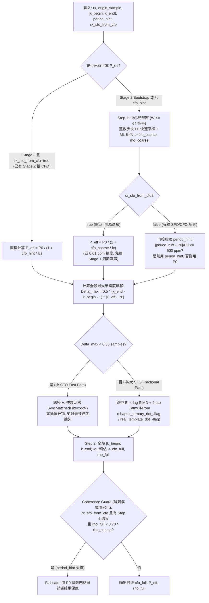
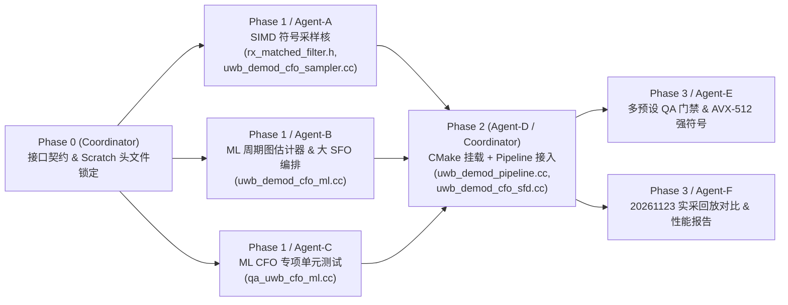

# OpenUWB CFO 估计架构重构执行方案（OpenCode Multi-Subagent Plan）

> 日期：2026-11-24  
> 适用分支：`feature/openuwb-rx-sic`（或由此切出的独立重构分支）  
> 适用对象：OpenCode（Coordinator + 多 Subagent 并行执行） / 维护者  
> 关联约定：[AGENTS.md](../AGENTS.md)、[原生UHD与C++构建使用说明.md](原生UHD与C++构建使用说明.md)

---

## 0. 背景与现有 CFO 流程的 6 大结构性缺陷

当前 `openuwb_rx` 的 CFO 估计路径在多次低 SNR / 实采修复后叠加了多层补丁，但在弱信号（如 8.84m 实采）、多径、突发干扰与大 SFO 场景下仍存在不稳定。经全链路代码审计（`uwb_demod_cfo_sfd.cc`、`uwb_demod_pipeline.cc`、`uwb_demod_timing.cc`、`demod_sync.h`），根因归纳为 6 点：

1. **相角提取 + 串行 unwrap + 无权 OLS 存在非线性门限崩溃**：`fit_cfo()`（`lib/phy/hrp/uwb_demod_cfo_sfd.cc:49-131`）对离散相关峰做 `std::arg()` + 串行 `±π` 解缠绕 + 无权线性回归。单个低 SNR 或强干扰点即可诱发永久性 `±2π` 跳周；边缘噪点在 OLS 中杠杆权重最大；`K=4` 折叠锚点还将无模糊频偏范围压缩至 `±122.8 kHz`。
2. **Timing argmax 与 CFO 相位采样紧耦合**：CFO 消费 Stage 1 各符号独立 argmax 对应的 `peak_corr`。多径信道下 argmax 在相邻抽头间跳变，直接向相位序列注入非物理相位阶跃。现存 `lock_integer_grid` 补丁仅覆盖 `fold_anchor_fit` 且仅在总漂移 `< 1.5` samples 时生效，未覆盖大 SFO 及非折叠路径（`grid_track` / `track_train`）。
3. **Stage 2 前沿溢出与 Stage 3 精估割裂**：`try_fold_acquire()` 可能将前沿锚点滚入 SFD（180° 极性翻转污染 OLS），而 Stage 3 在折叠路径上直接 `skip_tail_retrack` 跳过精估；非折叠路径则仅用尾部 40 个 SYNC 重跟踪，CRLB 方差比全前导 232 个 SYNC 高约 **125×**。
4. **`cfo_skip_initial_repetitions = 24` 按数组元素而非符号数跳过**：在 `K=4` 折叠锚点下实际跳过 96 个符号（浪费 37.5% 前导），而在点数 `<= 32` 时变为跳过 0 个符号。
5. **`probe_fold_phase()` 使用未匹配滤波的原始 IQ 自相关**：在 `-6 dB` 以下损失 ~20 dB 处理增益，极易输出随机参考相位。
6. **跨 4 个文件的魔法常量相互冲突**：`kFoldFastSymbols=4`、`kFoldMinSymbols=16`、`kFoldAnchorGroupSymbols=4`、`cfo_skip_initial_repetitions=24`、`cfo_min_fit_repetitions=32`、`skip_tail_retrack >=16`、`cfo_refit_min_peaks=64`、`lock_integer_grid <1.5`。

**本次重构目标**：用**“解耦的 SIMD 均匀/分数网格符号采样 + 复数域无跳周 ML 周期图估计器 + 物理自举大 SFO 策略 + SFD 锚定全前导精估”**一次性替代碎片化补丁，在低 SNR（低至 `-14 dB`）、多径、突发干扰及大 SFO（耦合 ±50 ppm / 解耦 ±200 ppm）下实现接近 CRLB 的稳定 CFO 估计，同时保持极低延迟与零热路径堆分配。

---

## 1. 不可违背的工程红线（Hard Constraints）

所有 Subagent 执行期间**必须严格遵守**：

1. **严禁手写标量点积，必须复用已有 AVX2 / AVX-512 / VOLK 原语**：
   - 所有 SYNC 模板匹配滤波采样**禁止**手写 `for (k = 0..L) acc += rx[k] * conj(tmpl[k])` 标量循环。
   - 必须复用 `include/openuwb/phy/hrp/rx/rx_matched_filter.h` 与 `rx_sync_opt.h` 中已有的 SIMD 核（详见 §2.1）。
2. **热路径零堆分配**：
   - `sample_sync_symbols_simd()` 与 `estimate_cfo_ml()` 内部**严禁**每包 `std::vector` 堆分配。
   - 所有中间缓冲（符号序列 `z[k]`、FFT 缓冲、幅值中位数缓冲）统一预分配在 `DemodScratch` 中并在 `DemodScratch::reserve()` 预留。
3. **编译分层与依赖红线**：
   - 保持 `support → dsp → phy_hrp` 严格单向依赖，核心库**零新增外部依赖**（不引入 FFTW 等第三方库）。
   - 重型非模板实现放在 `lib/phy/hrp/*.cc`，不把大段实现体写回公共头文件；**禁止 `-march=native`**，保持 `UwbSimd.cmake` 编译期 ISA 一致性。
   - 新增含 `uwb_simd_apply()` 的 QA 目标必须同步加入 `tests/CMakeLists.txt` 的 `UWB_QA_PCH_SIMD_TARGETS`。
4. **既有 QA 与 CLI 契约兼容**：
   - 保留 `fit_cfo()` 与 `stage_cfo()` 公开函数签名与单阶段 QA 行为（确保 `qa_uwb_demod_core_timing_cfo_sfd.cc` 与 `qa_uwb_radar_timing_core.cc` 全绿，不放宽任何既有 QA 容差）。
   - 保持 `cfo_refit_mode`（`0=legacy`, `1=auto`, `2=skip`）、`cfo_refit_action`、`stage_cfo_rotation_passes`、`stage_cfo_rotated_samples` 等遥测契约与 `qa_uwb_demod_core_cir_pipeline.cc` 兼容。
   - `--sic off` 保持零分配与既有 `stdout` 协议不变；纯 DSP 库禁止直接向 `stdout`/`stderr` 输出。
5. **洁净环境验证**：
   - 所有构建与 `ctest` 命令必须前缀 `env -u LD_LIBRARY_PATH`；禁止把全局 `install` 作为普通测试前置。

---

## 2. 核心架构与算法设计

### 2.1 SIMD 符号采样核（零标量点积，全面复用已有 AVX2 / AVX-512）

在给定参考符号起点与步长 $P_{\text{eff}}$ 后，对符号区间 $[k_{\text{begin}}, k_{\text{end}})$ 生成复数相关序列 $z_k$：

#### 路径 A：整数网格单点采样（小 SFO 快速路径）
直接构造并复用 `rxopt::SyncMatchedFilter`（`include/openuwb/phy/hrp/rx/rx_matched_filter.h:364`），其 `dot(rx + n_k)` 已按最优优先级自动分发：
1. **`ShapedSparseTemplate`（生产主路径，标准 HRP 脉冲模板）**：走 `shaped_ternary_dot_single()` → 内部调用 **`sparse_ternary_dot_8lag()`（AVX2 8-lag 并行稀疏加减，仅 64 次向量操作）+ 8-tap 脉冲 FIR**。具备完整脉冲匹配增益（比纯 `SparseCirTemplate` 高 +2.7 dB），232 个符号总耗时约 **23 µs**。
2. **`SparseCirTemplate`**（显式启用纯稀疏无脉冲模式时）：`sparse_ternary_dot_single()`。
3. **`RealSyncTemplate`（非标准纯实数模板，如部分 QA 夹具）**：走 **`real_template_dot_single_avx2()`（AVX2 + FMA）**。
4. **任意复数模板兜底**：走 `openuwb::core::conjugate_dot()`（**VOLK `volk_32fc_x2_conjugate_dot_prod_32fc`**）。

#### 路径 B：4-lag 批量 SIMD + 4-tap Catmull-Rom 子样点插值（大 SFO 路径）
当目标符号位置为分数样点 $t_k = q_k + \delta_k$（$q_k = \lfloor t_k \rfloor$，$\delta_k \in [0, 1)$）时，利用相关运算的线性性质，先以**单次 SIMD 批量调用**计算连续 4 个整数 lag 的相关值 $z[q_k-1], z[q_k], z[q_k+1], z[q_k+2]$，再用 4-tap Catmull-Rom 权重（与 `rx_phase_sfo.h` 的 `build_fractional_cir_bank()` 同源）合成平滑无阶跃的 $z(t_k)$：

$$w_{-1} = -\tfrac{1}{2}\delta + \delta^2 - \tfrac{1}{2}\delta^3, \quad w_0 = 1 - \tfrac{5}{2}\delta^2 + \tfrac{3}{2}\delta^3, \quad w_1 = \tfrac{1}{2}\delta + 2\delta^2 - \tfrac{3}{2}\delta^3, \quad w_2 = -\tfrac{1}{2}\delta^2 + \tfrac{1}{2}\delta^3$$

各模板类型的 SIMD 4-lag 分发策略（**均复用已有 AVX2 / AVX-512 核**）：
- **`ShapedSparseTemplate`（主路径）**：在 `rx_matched_filter.h` 新增极薄内联函数 `shaped_ternary_dot_4lag(rx, tmpl, out[4])`：
  - 由于 `tmpl.nt <= 8`，4 个连续 lag 共需 `nt + 3 <= 11 <= 16` 个稀疏点 `c[0..10]`；
  - 只需**调用 1 次已有的 `sparse_ternary_dot_16lag(rx, tmpl.code, c)`（AVX2 / AVX-512）**，再对 `j = 0..3` 做 4 次短 8-tap 实脉冲 FIR 即得 `out[0..3]`！
  - 边界检查要求：`q_k >= 1` 且 `q_k - 1 + last_code_pos + 16 <= n`（或退化到保证 `q_k - 1 + L + 3 <= n` 且 16-lag 不越界；贴近窗口末端 `< 16` 样点时自动回退到安全 4×`shaped_ternary_dot_single`）。
  - 成本仅 ~0.15 µs/symbol（232 符号约 **35 µs**），比调用 4 次单点快 >3×。
- **`RealSyncTemplate`**：直接复用已有 **`real_template_dot_4lag(rx + q_k - 1, real_taps_dup, L, z4)`**（AVX2+FMA 4-lag 共享模板加载）。
- **`SparseCirTemplate`**：直接复用已有 **`sparse_ternary_dot_4lag(rx + q_k - 1, sparse, z4)`**（AVX2）。
- **任意复数模板**：4 次 `openuwb::core::conjugate_dot()`（VOLK）。

---

### 2.2 复数域无跳周 ML 周期图频率估计器（`estimate_cfo_from_symbols_ml`）

输入：均匀符号间隔 $P_{\text{eff}}$ 采得的复数序列 $z_0, z_1, \dots, z_{M-1}$（$M \ge 8$，典型 $M \in [48, 232]$）。

1. **抗突发干扰软限幅（Huber / Median Soft-Clipping，零堆分配）**：
   - 将 $|z_k|$ 写入 `scratch.cfo_mag_buf`（预留 256），用 `std::nth_element` 求中位数 $m = \text{median}(|z_k|)$。
   - 令限幅阈值 $\tau = 2.5\, m$（若 $m \le 0$ 则报错返回 `ok = false`）。
   - $\tilde{z}_k = z_k \cdot \min(1, \tau / |z_k|)$。
   - **效果**：正常热噪声下保留自然幅度加权（近似最大比合并），强突发脉冲干扰被截断而不污染频谱，且无任何相角非线性操作。

2. **全局无模糊粗搜（Zero-Padded Radix-2 FFT）**：
   - 取 $N_{\text{fft}} = 1024$（若 $M > 512$ 则取 `next_pow2(2 * M)`），复数缓冲复用 `scratch.cfo_fft_buf`（`std::vector<std::complex<double>>`，预留 1024）。
   - 将 $\tilde{z}_0 \dots \tilde{z}_{M-1}$ 写入前 $M$ 项，其余清零，执行零依赖原地 Radix-2 FFT（可复用 `openuwb::core::fft_radix2` 同构算法，但提供无异常/无分配的指针或 scratch 重载）。
   - 在合法搜索频段内（默认全 Nyquist $\pm f_s / (2 P_{\text{eff}}) \approx \pm 491\text{ kHz}$，可选通过 `max_abs_cfo_hz` 限幅）寻找最大功率谱峰 $k^*$：
     - 1024 点 bin 间距 $\Delta f \approx 960\text{ Hz}$，远窄于 232 符号周期图主瓣半宽（$\approx 2.1\text{ kHz}$），**100% 保证落在全局主瓣内，彻底杜绝 `±2π` 跳周**。
   - 对 $k^*-1, k^*, k^*+1$ 做三点抛物线插值得到初始角频率 $\omega_0 \in [-\pi, \pi)$（rad/symbol）。

3. **Newton-Raphson 周期图精修（达到 CRLB）**：
   - 目标函数（零中心化索引 $u_k = k - \frac{M-1}{2}$ 使导数数值条件最优）：
     $$S_0(\omega) = \sum_{k=0}^{M-1} \tilde{z}_k e^{-j \omega u_k}, \quad S_1(\omega) = \sum_{k=0}^{M-1} u_k \tilde{z}_k e^{-j \omega u_k}, \quad S_2(\omega) = \sum_{k=0}^{M-1} u_k^2 \tilde{z}_k e^{-j \omega u_k}$$
   - 令 $J(\omega) = |S_0(\omega)|^2$，其一阶、二阶导数为：
     $$J'(\omega) = 2\,\text{Im}\!\left(S_0^*(\omega)\, S_1(\omega)\right), \qquad J''(\omega) = 2\left(|S_1(\omega)|^2 - \text{Re}\!\left(S_0^*(\omega)\, S_2(\omega)\right)\right)$$
   - 执行最多 5 步牛顿迭代（收敛判据 $|\Delta\omega| < 10^{-8}\text{ rad/symbol}$，对应 `< 0.0015 Hz`）：
     - 仅当 $J''(\omega) < 0$（凹区间）时取 $\Delta\omega = -J'(\omega) / J''(\omega)$，并限制单步 $|\Delta\omega| \le \pi / M$；
     - **回溯保护**：若 $J(\omega + \Delta\omega) < J(\omega)$，步长减半重试（最多 3 次），保证 $J(\omega)$ 单调不降、永不发散。
   - 递推复旋转优化：每步用 `step = exp(-j * w)` 递推旋转（每 32 点精确重锚一次 `cos/sin` 防止漂移），5 步共 `< 3 µs`。

4. **输出指标**：
   - 频偏：`cfo_hz = omega_hat * sample_rate_hz / (2.0 * M_PI * symbol_period_samples)`
   - 相干度：`coherence = |S_0(omega_hat)| / (sum |tilde_z_k| + 1e-12)` $\in [0, 1]$
   - 参考中心相位：`center_phase_rad = arg(S_0(omega_hat))`

---

### 2.3 大 SFO 稳定性与效率方案（慎重设计）

大 SFO 的核心矛盾在于：
- **不补偿 SFO**：256 个 SYNC 符号在 `±20 ppm` 下累积漂移 `5.2 samples`（`±50 ppm` 达 `13 samples`），远超脉冲主瓣半宽（`~1.5–2.0 samples`），首尾符号完全滑出直达径主瓣，导致幅度归零与多径相位畸变。
- **盲目使用 Stage 1 的 `timing.measured_period`**：在低 SNR（`-8 ~ -14 dB`）或多径/干扰下，Stage 1 OLS 测得的 `measured_period` 往往有 `±50~200 ppm` 误差，盲目据此滑动采样网格反而会人为制造虚假漂移，把稳定信号拖偏！

本方案采用**“物理自举两步法 + 漂移门控零成本切换 + 相干度回退保护”**解决该矛盾：



**关键参数与物理合理性论证**：
1. **Step 1 中心局部窗宽度 $W = \min(64, k_{\text{end}} - k_{\text{begin}})$**：
   - 在 `±30 ppm` 下，64 个符号两端距中点的漂移仅 `±0.97 samples`（仍在主瓣内且关于中点对称，无频率偏置）；
   - 即使在 `-14 dB` AWGN 下，64 符号 ML 处理增益达 `+39 dB`，粗估误差 `< 50 Hz` → 推导出的 `SFO` 误差 `< 0.008 ppm`（256 符号累计误差 `< 0.002 samples`），**比 Stage 1 Timing OLS 精度高 3–4 个数量级**！
   - 若 `rx_sfo_from_cfo == false` 且 `period_hint` 指示极端大 SFO（如 `±200 ppm` 压测，`qa_uwb_demod_core_cir_pipeline.cc:450`），Step 1 局部窗可动态缩放为 `W = clamp(floor(1.5 / max(|period_hint - P0|, 1e-6)), 16, 64)`，或直接使用 `period_hint` 走路径 B，确保不失锁。
2. **切换阈值 $\Delta_{\max} = 0.35\text{ samples}$**：
   - 覆盖 `±2.5 ppm @ 256 SYNC` 与 `±10 ppm @ 64 SYNC`；在此范围内脉冲幅度衰减 `< 2%`、相位畸变可忽略，走路径 A 可省去全部插值开销。
   - 超过 `0.35 samples` 自动无缝切换路径 B（`sparse_ternary_dot_16lag` + Catmull-Rom），在 `±50 ppm @ 256 SYNC`（`13 samples` 漂移）下全程紧贴直达径峰顶，零整数跳变锯齿。
3. **耗时预算（AVX2，232 SYNC 符号）**：
   - 小 SFO（路径 A）：Step 1（64 符号，~6 µs）+ Step 2（复用的 64 符号可跳过重算，仅补采剩余 168 符号，~17 µs）+ FFT/Newton（~10 µs）≈ **33 µs**（Stage 3 有 `cfo_hint` 时省去 Step 1，直接一步完成 ≈ **33 µs**）。
   - 大 SFO（路径 B）：Step 1（~6 µs）+ Step 2（232 符号 16-lag + Catmull-Rom，~35 µs）+ FFT/Newton（~10 µs）≈ **51 µs**。
   - **增量优化**：若 Step 1 与 Step 2 均走路径 A（`Delta_max < 0.35` 且参考点一致），Step 1 已采样的中间 64 个符号 $z_k$ **直接复用**，不重复计算！

---

### 2.4 Pipeline 两阶段接入策略（`uwb_demod_pipeline.cc`）

1. **Stage 2（Bootstrap CFO）**：
   - 输入：Stage 1 粗定位的 `timing.preamble_start_sample`（允许有若干符号整数倍偏差）。
   - 安全内部区间：
     - 令 $N_{\text{rep}} = \text{profile.preamble\_repetitions}$。
     - 安全边界 `margin = std::min<size_t>(32, N_rep / 8)`（256-SYNC 时为 `[32, 224)` 共 192 个符号；64-SYNC 时为 `[8, 56)` 共 48 个符号；若 `N_rep < 16` 则退化到 `[0, N_rep)`）。
     - 避开发端起振瞬态，同时防止前沿误差导致采样滚入 SFD。
   - 若 `estimate_cfo_ml()` 成功，填入 `res.cfo`（`cfo_hz`, `ok = true`, `peaks_used` 等），并按 `rx_sfo_from_cfo` 立即刷新 `res.timing.measured_period`。
   - 若因极短帧/异常窗口导致 `estimate_cfo_ml()` 不可用（例如 `N_rep < 8` 或窗口截断导致可用符号 `< 8`），自动回退到现有 `fit_cfo()`，保证所有极端边界单测兼容。

2. **Stage 3（Final CFO，SFD 锚定后）**：
   - SFD 精确锁定 `sfd_start_sample` 后，前导最后一个 SYNC 的精确结束位置已知：
     - `preamble_end = sfd_start_sample`
     - `k_skip = std::min(profile.cfo_skip_initial_repetitions, N_rep > kMin ? N_rep - kMin : 0)`（**按真实符号数跳过**，例如 256-SYNC 跳过前 24 个符号，取满后 **232 个纯净 SYNC 符号 `[24, 256)`**；64-SYNC 取 `[24, 64)` 共 40 个符号）。
   - 直接调用 `estimate_cfo_ml()`（携带 Stage 2 的 `cfo_hint`，直接一步完成全前导精确估计），**彻底替代**原有的 `retrack_tail_timing()` + 40-symbol 尾部重拟合，**取消 `skip_tail_retrack` 的折叠路径割裂**。
   - **保留并对齐 `cfo_refit_mode` 契约**（兼容 `qa_uwb_demod_core_cir_pipeline.cc`）：
     - `cfo_refit_mode == 2 (skip)`：跳过 Stage 3 重估与第二次旋转，`cfo_refit_action = 2`。
     - `cfo_refit_mode == 1 (auto)`：运行全前导 ML CFO；若 Stage 2 与 Stage 3 频偏差在全帧跨度上的累计相位漂移 `< profile.cfo_refit_skip_rad` 且 Stage 2 `peaks_used >= profile.cfo_refit_min_peaks`，复用 Stage 2 的已旋转缓冲（`cfo_refit_action = 1`，`stage_cfo_rotation_passes = 1`）；否则仅重旋所需范围（`cfo_refit_action = 0`）。
     - `cfo_refit_mode == 0 (legacy 默认)`：运行全前导 ML CFO 并执行第二次范围旋转（`cfo_refit_action = 0`，`stage_cfo_rotation_passes = 2`），确保所有检查 `stage_cfo_rotation_passes >= 2` 的 QA 契约全部通过。

3. **Timing 阶段清理边界（`uwb_demod_timing.cc`）**：
   - **保留**已有且验证有效的 Timing 改进：`K=4` 快速折叠、PAR 突出度接受门限、`kFoldAnchorGroupSymbols = 4`、`groups` 上限 64。
   - **保留** `fold_anchor_fit` 对 `preamble_start_sample` 和 `measured_period` 的服务，但不再把 `peak_corr` 的多径跳变问题转嫁给 CFO（CFO 不再读取 `timing.peak_corr`）。
   - `probe_fold_phase()` 在本次重构中保持不动（或仅做注释标记），避免扩大 Timing 变更面引发意外回归。

---

## 3. 多 Subagent 协作编排与文件所有权矩阵

为避免并行编辑冲突，任务拆分为 **4 个阶段（Phase 0 → Phase 1 → Phase 2 → Phase 3）**，Phase 1 的 3 个 Subagent 与 Phase 3 的 2 个 Subagent **完全零文件重叠，可全速并行**。

### 3.1 总览拓扑



### 3.2 独占文件所有权矩阵

| 阶段 | Agent | 独占修改/新建文件（其他 Agent 严禁触碰） | 只读参考文件 |
| :--- | :--- | :--- | :--- |
| **Phase 0** | **Coordinator** | `include/openuwb/phy/hrp/rx/demod_cfo.h`<br>`include/openuwb/phy/hrp/rx/demod_scratch.h` | `profile.h`, `demod_result.h`, `rx_matched_filter.h` |
| **Phase 1** | **Agent-A** (SIMD Sampler) | `include/openuwb/phy/hrp/rx/rx_matched_filter.h`（仅新增 `shaped_ternary_dot_4lag`）<br>`lib/phy/hrp/uwb_demod_cfo_sampler.cc` *(新建)* | `demod_cfo.h`, `demod_scratch.h`, `rx_sync_opt.h`, `rx_phase_sfo.h` |
| **Phase 1** | **Agent-B** (ML Estimator) | `lib/phy/hrp/uwb_demod_cfo_ml.cc` *(新建)* | `demod_cfo.h`, `demod_scratch.h`, `include/openuwb/dsp/tone_canceller.h` |
| **Phase 1** | **Agent-C** (Unit Tests) | `tests/unit/phy/qa_uwb_cfo_ml.cc` *(新建)* | `demod_cfo.h`, `qa_uwb_demod_core_timing_cfo_sfd.cc`, `qa_uwb_demod_core_cir_pipeline.cc` |
| **Phase 2** | **Agent-D** (Integration) | `lib/phy/hrp/CMakeLists.txt`<br>`tests/CMakeLists.txt`<br>`lib/phy/hrp/uwb_demod_pipeline.cc`<br>`lib/phy/hrp/uwb_demod_cfo_sfd.cc`（仅按需微调） | Phase 1 全部产出、`uwb_demod_timing.cc` |
| **Phase 3** | **Agent-E** (QA Gate) | 只运行构建与测试，不改源码（发现缺陷回报 Coordinator） | `AGENTS.md`, `CMakePresets.json` |
| **Phase 3** | **Agent-F** (Replay & Perf) | `docs/performance/CFO架构重构验收报告_2026-11-24.md` *(新建)* | `testdata/dw3000_*_20261123/` |

---

## 4. 分阶段详细执行指令（可直接作为 Subagent Prompt）

### Phase 0：接口契约与 Scratch 锁定（Coordinator，串行）

**目标**：在不破坏现有构建的前提下，锁定 Phase 1 三个并行 Subagent 共享的数据结构与函数签名。

**具体任务**：
1. 在 `include/openuwb/phy/hrp/rx/demod_cfo.h` 新增结构体与声明（保留既有 `fit_cfo` / `derotate_cfo_range` / `stage_cfo` 原封不动）：
   ```cpp
   struct CfoMlConfig {
       size_t symbol_begin = 0;          // 起始 SYNC 符号索引（相对 origin_sample，包含）
       size_t symbol_end = 0;            // 结束 SYNC 符号索引（相对 origin_sample，不包含）
       int64_t origin_sample = 0;        // 第 0 个 SYNC 符号起点（相对 rx[0]）
       double nominal_period = static_cast<double>(kQm35SamplesPerSymbol);
       double period_hint = 0.0;         // 可选：Stage 1 测得周期（解耦 SFO 时使用）
       double cfo_hint_hz = 0.0;         // 可选：Stage 2 粗估 CFO（Stage 3 跳过 Step 1）
       bool has_cfo_hint = false;
       bool sfo_from_cfo = true;         // 与 profile.rx_sfo_from_cfo 对齐
       double carrier_freq_hz = 6489.6e6;
       double sample_rate_hz = 998.4e6;
       double max_abs_cfo_hz = 0.0;      // <=0 表示全 Nyquist (±fs/(2*P))
       double frac_drift_threshold_samples = 0.35; // 切换 4-lag Catmull-Rom 阈值
       double huber_median_scale = 2.5;  // 软限幅中位数倍率（<=0 禁用）
       size_t coarse_window_symbols = 64;
   };

   struct CfoMlResult {
       bool ok = false;
       double cfo_hz = 0.0;
       double effective_period = 0.0;
       double coherence = 0.0;           // [0, 1]
       double center_phase_rad = 0.0;
       size_t symbols_used = 0;
       bool used_fractional_grid = false;
       bool used_coherence_fallback = false;
   };

   // SIMD 符号采样核（实现于 uwb_demod_cfo_sampler.cc）：
   // 从 rx 按固定/分数网格采集 [symbol_begin, symbol_end) 的复相关值写入 out_z。
   // 返回实际成功采样的连续符号数（遇窗口越界会安全截断并返回有效范围）。
   size_t sample_sync_symbols_simd(
       const std::complex<float>* rx,
       size_t n,
       const Qm35825Profile& profile,
       const std::vector<std::complex<float>>& template_wf,
       int64_t origin_sample,
       size_t symbol_begin,
       size_t symbol_end,
       double period_samples,
       bool use_fractional_interp,
       DemodScratch& scratch,
       std::complex<float>* out_z,
       size_t* out_first_symbol = nullptr);

   // 纯复数序列 ML 频率估计器（实现于 uwb_demod_cfo_ml.cc）：
   // 便于单元测试直接注入合成复数序列（无 I/O、零堆分配）。
   bool estimate_cfo_from_symbols_ml(
       const std::complex<float>* z,
       size_t count,
       double symbol_period_samples,
       double sample_rate_hz,
       double max_abs_cfo_hz,
       double huber_median_scale,
       DemodScratch& scratch,
       CfoMlResult& out);

   // 端到端两步自适应 ML CFO 估计器（实现于 uwb_demod_cfo_ml.cc）：
   bool estimate_cfo_ml(
       const std::complex<float>* rx,
       size_t n,
       const Qm35825Profile& profile,
       const std::vector<std::complex<float>>& template_wf,
       const CfoMlConfig& cfg,
       DemodScratch& scratch,
       CfoMlResult& out);
   ```
2. 在 `include/openuwb/phy/hrp/rx/demod_scratch.h` 的 `DemodScratch` 中新增预分配工作区，并在 `reserve()` 中预留：
   ```cpp
   // ML CFO estimator zero-allocation scratch buffers.
   std::vector<std::complex<float>> cfo_sym_z;       // reserve(512)
   std::vector<std::complex<float>> cfo_coarse_z;    // reserve(128)
   std::vector<std::complex<double>> cfo_fft_buf;    // reserve(1024)
   std::vector<float> cfo_mag_buf;                   // reserve(512)
   ```
3. **Phase 0 门禁**：
   ```sh
   env -u LD_LIBRARY_PATH cmake --preset dev-avx2
   env -u LD_LIBRARY_PATH cmake --build --preset dev-avx2 -j
   ```

---

### Phase 1 / Agent-A：SIMD 符号采样核（与 Agent-B / Agent-C 并行）

**独占文件**：
- `include/openuwb/phy/hrp/rx/rx_matched_filter.h`（仅新增 `shaped_ternary_dot_4lag`）
- `lib/phy/hrp/uwb_demod_cfo_sampler.cc`（新建）

**实现要求**：
1. 在 `rx_matched_filter.h` 中 `shaped_ternary_dot_single()` 之后新增内联函数：
   ```cpp
   // 4 consecutive lags using ONE 16-lag AVX2/AVX-512 sparse ternary dot + 4x short pulse FIR.
   // Caller guarantees rx has at least max_sparse_offset + 16 valid samples.
   inline void shaped_ternary_dot_4lag(
       const std::complex<float>* rx,
       const ShapedSparseTemplate& tmpl,
       std::complex<float> out[4])
   {
       std::complex<float> c[16];
       sparse_ternary_dot_16lag(rx, tmpl.code, c);
       const size_t nt = tmpl.nt;
       for (size_t j = 0; j < 4; ++j) {
           std::complex<float> acc(0.0f, 0.0f);
           for (size_t k = 0; k < nt; ++k)
               acc += tmpl.pulse[k] * c[j + k];
           out[j] = acc;
       }
   }
   ```
   注意：核对 `ShapedSparseTemplate::kMaxPulse == 8`，因此 `j + k <= 3 + 7 = 10 < 16`，永不越界。同时检查 `tmpl.code` 的最大样本偏移（`pos_off`/`neg_off` 是 float 偏移，除以 2 为复数样本偏移），确保越界保护准确无误。
2. 在 `lib/phy/hrp/uwb_demod_cfo_sampler.cc` 实现 `sample_sync_symbols_simd()`：
   - 准备模板缓存（完全复用 `DemodScratch` 中的 `real_sync_template`、`cir_template`、`shaped_sync_template`）：
     - 若 `template_wf.size() == 2 * kQm35ChipsPerSymbol`（1016），调用 `prepare_sparse_sync_template()` + `rxopt::ensure_shaped_sparse_template()`。
     - 调用 `rxopt::ensure_real_sync_template(template_wf, scratch.real_sync_template)`。
     - 构造 `rxopt::SyncMatchedFilter mf(...)`（优先 `shaped_tmpl`，其次 `real_taps_dup`，最后 `volk_complex = true` 走 `openuwb::core::conjugate_dot`）。
     - **注意**：即使 `profile.rx_timing_sparse == false`，只要 `shaped_tmpl` 重建验证通过（它与 dense 模板能量误差 `< 0.02 dB`），优先使用 `shaped_tmpl` 或 `real_sync_template` 以获得 AVX2 加速，**严禁退化为手写标量点积**。
   - 以符号区间中点 `k_mid = 0.5 * (symbol_begin + symbol_end - 1)` 锚定，或严格按 `t_k = origin_sample + k * period_samples`（确保 `t_k` 相对 `origin_sample` 连续无偏移）：
     - **整数路径（`!use_fractional_interp`）**：`int64_t pos = std::llround(t_k)`，若 `pos < 0 || pos + L > n` 则跳过/裁剪连续有效区间，调用 `mf.dot(rx + pos)`。
     - **分数路径（`use_fractional_interp`）**：`int64_t q = static_cast<int64_t>(std::floor(t_k))`，`float d = static_cast<float>(t_k - static_cast<double>(q))`：
       - 若 `d < 1e-4f`，直接走 `mf.dot(rx + q)`；
       - 否则检查 4-lag 边界 `q >= 1 && q - 1 + L + 3 <= n`（若走 `shaped_ternary_dot_4lag` 额外检查 `q - 1 + max_code_sample_off + 16 <= n`，末端不足 16 样点时安全回退 4×`shaped_ternary_dot_single`）；
       - 按模板类型分发 `shaped_ternary_dot_4lag` / `real_template_dot_4lag` / `sparse_ternary_dot_4lag` / 4×`conjugate_dot` 得到 `z4[0..3]`；
       - 用 4-tap Catmull-Rom 权重合成 `out_z[idx]`。
   - 保持 `out_z` 为连续符号序列（若前端有越界裁剪，记录实际首个有效符号索引到 `*out_first_symbol`；遇尾部越界即停，避免中间出现空洞破坏均匀采样假设）。

---

### Phase 1 / Agent-B：复数域 ML 周期图估计器与大 SFO 编排（与 Agent-A / Agent-C 并行）

**独占文件**：
- `lib/phy/hrp/uwb_demod_cfo_ml.cc`（新建）

**实现要求**：
1. **零分配原地 Radix-2 FFT 内部助手**：
   - 在匿名命名空间中实现 `fft_radix2_inplace(std::complex<double>* a, size_t n)`（参考 `include/openuwb/dsp/tone_canceller.h:109`，去掉 `throw` 改为返回 `bool`，无需临时分配）。
2. **实现 `estimate_cfo_from_symbols_ml()`**：
   - 防御检查：`z == nullptr || count < 8 || symbol_period_samples <= 0.0 || sample_rate_hz <= 0.0` 或存在非有限值 → 返回 `false`。
   - **Step 1：Huber 中位数软限幅**（使用 `scratch.cfo_mag_buf`）：
     - 计算 `mag[k] = std::abs(z[k])`，`std::nth_element` 求中位数 `med`。
     - 若 `med <= 1e-12f`，退化为用均值或返回 `false`（全零输入）。
     - 若 `huber_median_scale > 0.0`，令 `clip = static_cast<float>(huber_median_scale) * med`，对超限点按 `clip / mag[k]` 缩放，同时累计 `sum_mag = sum |tilde_z_k|`。
   - **Step 2：Zero-Padded FFT 粗搜**（使用 `scratch.cfo_fft_buf`）：
     - `nfft = 1024`（若 `count > 512`，取 `next_pow2(2 * count)`）。
     - `scratch.cfo_fft_buf.assign(nfft, {0.0, 0.0})`，填入软限幅后的复数序列，调用 `fft_radix2_inplace`。
     - 频率范围过滤：若 `max_abs_cfo_hz > 0.0`，换算为 `max_w = 2*pi * max_abs_cfo_hz * symbol_period_samples / sample_rate_hz`，仅搜索 `|w_bin| <= max_w` 的 bin；否则搜索全部 `nfft` 个 bin。
     - 找到最大功率 `|X[k]|^2` 的 `k_best`（注意 FFT 频率折返：`k < nfft/2` 对应 `[0, pi)`，`k >= nfft/2` 对应 `[-pi, 0)`），对环形相邻 3 点 `(k_best-1+nfft)%nfft, k_best, (k_best+1)%nfft` 做幅值抛物线插值，得到初始角频率 `w0`。
   - **Step 3：Newton-Raphson 精修**：
     - 零中心化索引 `u_k = k - 0.5 * (count - 1)`。
     - 每次迭代以步进复数递推计算 `S0, S1, S2`（每 32 点用 `std::cos/sin` 刷新防累积误差）。
     - 计算 `J = norm(S0)`、`J1 = 2 * Im(conj(S0) * S1)`、`J2 = 2 * (norm(S1) - Re(conj(S0) * S2))`。
     - 若 `J2 < -1e-18`，取 `step = clamp(-J1 / J2, -pi/count, +pi/count)`；带最多 3 次 halving 回溯保证 `J_new >= J`。
     - 收敛条件 `|step| < 1e-8`，最多 5 次迭代。
   - 填写 `CfoMlResult`：`ok = true`, `cfo_hz`, `effective_period = symbol_period_samples`, `coherence = std::abs(S0) / (sum_mag + 1e-12)`, `center_phase_rad = std::arg(S0)`, `symbols_used = count`。
3. **实现 `estimate_cfo_ml()`（两步大 SFO 自适应编排）**：
   - 校验 `cfg.symbol_end > cfg.symbol_begin` 且符号数 `>= 8`。
   - **确定 `p_eff`**：
     - 若 `cfg.has_cfo_hint && cfg.sfo_from_cfo && cfg.carrier_freq_hz > 0.0`：直接 `p_eff = cfg.nominal_period / (1.0 + cfg.cfo_hint_hz / cfg.carrier_freq_hz)`，跳过 Step 1。
     - 否则执行 **Step 1（中心局部窗粗估）**：
       - 确定局部窗宽度 `W`：默认 `std::min(cfg.coarse_window_symbols, total_syms)`；若 `!cfg.sfo_from_cfo && cfg.period_hint > 0.0`，当 `|cfg.period_hint - cfg.nominal_period| > 1e-6` 时可按 `clamp(floor(1.5 / diff), 16, W)` 动态缩窗（避免解耦极端 ±200 ppm SFO 在 Step 1 失锁）。
       - 中心窗 `[c_begin, c_end)` 居中于 `[cfg.symbol_begin, cfg.symbol_end)`。
       - 用 `sample_sync_symbols_simd(..., cfg.nominal_period, /*use_frac=*/false, ..., scratch.cfo_coarse_z.data())` 采样并调用 `estimate_cfo_from_symbols_ml()` 得到 `coarse_res`。
       - 若 `cfg.sfo_from_cfo && cfg.carrier_freq_hz > 0.0 && coarse_res.ok`：
         `p_eff = cfg.nominal_period / (1.0 + coarse_res.cfo_hz / cfg.carrier_freq_hz)`。
       - 否则（解耦模式）：若 `cfg.period_hint > 0.0 && std::abs(cfg.period_hint - cfg.nominal_period) <= 500e-6 * cfg.nominal_period`，取 `p_eff = cfg.period_hint`；否则取 `p_eff = cfg.nominal_period`。
   - **自适应零成本切换**：
     - 计算 `delta_max = 0.5 * (total_syms - 1) * std::abs(p_eff - cfg.nominal_period)`。
     - `use_frac = (delta_max >= cfg.frac_drift_threshold_samples)`。
     - 增量复用优化：若 Step 1 已运行、`!use_frac`、且 `p_eff` 与 `nominal_period` 的整数取整位置在 `[c_begin, c_end)` 上完全一致，可直接拷贝 `cfo_coarse_z` 仅采左右两侧，或统一走 `sample_sync_symbols_simd`（仅多 6 µs，代码更简洁，优先保证清晰正确）。
   - **Step 2（全段采样与 ML 精估）**：
     - `sample_sync_symbols_simd(..., p_eff, use_frac, ..., scratch.cfo_sym_z.data())` → `estimate_cfo_from_symbols_ml()` 得到 `full_res`。
   - **Coherence Guard（防解耦模式 `period_hint` 失真）**：
     - 若 `!cfg.sfo_from_cfo && coarse_res.ok && (!full_res.ok || full_res.coherence < 0.70 * coarse_res.coherence)`：
       回退输出 `coarse_res` 并标记 `used_coherence_fallback = true`。

---

### Phase 1 / Agent-C：ML CFO 专项单元测试套件（与 Agent-A / Agent-B 并行）

**独占文件**：
- `tests/unit/phy/qa_uwb_cfo_ml.cc`（新建，Boost.Test）

**测试用例清单（全部须自包含、确定性随机种子、零外部数据文件依赖）**：
1. `test_cfo_ml_wide_frequency_sweep_no_cycle_slip`：
   - 合成 256-SYNC HRP 前导（复用 `openuwb::phy::hrp` 编码与 `kPulse48` 脉冲生成），注入 CFO ∈ `{0, ±1 kHz, ±50 kHz, ±175 kHz, ±350 kHz, ±450 kHz}`。
   - 断言全部误差 `< 5 Hz`，相干度 `> 0.99`，无 `±2π` 跳周。
2. `test_cfo_ml_low_snr_awgn_crlb_and_zero_slips`：
   - 固定种子 AWGN，在 `-6 dB`、`-10 dB`、`-14 dB`（每档 20 次 Monte Carlo）运行 232 符号 ML CFO（CFO = `+42.5 kHz`）。
   - 断言 `-6 dB` / `-10 dB` 零跳周且最大误差 `< 80 Hz`；`-14 dB` 零跳周且最大误差 `< 200 Hz`（对比旧 `fit_cfo` 在 `-10 dB` 即频繁跳周）。
3. `test_cfo_ml_burst_jammer_robustness`：
   - 在 232 个符号中随机挑 30 个符号注入 `+20 dB` 突发干扰脉冲（相位随机）。
   - 断言启用 Huber 软限幅后误差 `< 150 Hz`，且显著优于关闭限幅。
4. `test_cfo_ml_multipath_no_tap_hopping`：
   - 构造 3 径信道（主径 `0 dB` + 延迟 2 samples `-1 dB` 相位 120° + 延迟 5 samples `-3 dB` 相位 -70°），加 `-4 dB` AWGN。
   - 断言固定网格采样无跳抽头，CFO 误差 `< 50 Hz`。
5. `test_cfo_ml_large_sfo_coupled_and_decoupled`：
   - **耦合大 SFO**：`+27 ppm`（`+175 kHz`）与 `-50 ppm`（`-324.5 kHz`），验证 `rx_sfo_from_cfo = true` 下自动触发 `used_fractional_grid == true`，CFO 误差 `< 20 Hz`，`effective_period` 误差 `< 1e-4` samples。
   - **解耦大 SFO**：`rx_sfo_from_cfo = false`，`CFO = +30 kHz`、`SFO = +200 ppm`（带正确 `period_hint`），验证误差 `< 50 Hz`；再注入错误 `period_hint`（偏差 `+400 ppm`）验证 `used_coherence_fallback == true` 保底不崩溃。
6. `test_cfo_sampler_simd_equivalence`：
   - 对比 `shaped_ternary_dot_4lag`（16-lag AVX2/AVX-512）与 4 次 `shaped_ternary_dot_single` 的输出，断言最大绝对误差 `< 1e-5`（逐项一致）。
   - 对比 `sample_sync_symbols_simd` 在 `ShapedSparseTemplate` vs `RealSyncTemplate` 下的输出相位差，断言 `< 0.01 rad`。

---

### Phase 2 / Agent-D（或 Coordinator）：CMake 挂载与 Pipeline 整合（串行）

**前置条件**：Phase 1 的 Agent-A、Agent-B、Agent-C 全部产出就位。

**独占文件**：
- `lib/phy/hrp/CMakeLists.txt`
- `tests/CMakeLists.txt`
- `lib/phy/hrp/uwb_demod_pipeline.cc`
- `lib/phy/hrp/uwb_demod_cfo_sfd.cc`（仅按需微调，保持 `fit_cfo()` 签名与既有单阶段行为不变）

**具体任务**：
1. **CMake 注册**：
   - 在 `lib/phy/hrp/CMakeLists.txt` 的 `if(UWB_ENABLE_RX)` 列表中追加：
     - `uwb_demod_cfo_sampler.cc`
     - `uwb_demod_cfo_ml.cc`
   - 在 `tests/CMakeLists.txt` 注册 `qa_uwb_cfo_ml.cc`（加入 `UWB_QA_PCH_SIMD_TARGETS` 并打 `rx_sic` 标签）。
2. **先编译并跑通 `qa_uwb_cfo_ml`**：
   ```sh
   env -u LD_LIBRARY_PATH cmake --preset dev-avx2
   env -u LD_LIBRARY_PATH cmake --build --preset dev-avx2 --target qa_uwb_cfo_ml -j
   env -u LD_LIBRARY_PATH ctest --test-dir build/dev-avx2 -R qa_uwb_cfo_ml --output-on-failure
   ```
3. **接入 `uwb_demod_pipeline.cc`**：
   - 在 `run_initial_cfo_and_bootstrap_sfd()` 中（Stage 2 Bootstrap）：
     - 构造 `CfoMlConfig`（安全内部区间 `[margin, N_rep - margin)`，`origin_sample = res.timing.preamble_start_sample`，`period_hint = res.timing.measured_period`，`sfo_from_cfo = profile.rx_sfo_from_cfo`）。
     - 若可用符号 `>= 8` 且 `estimate_cfo_ml()` 成功：写入 `res.cfo`（`ok = true`, `cfo_hz = ml.cfo_hz`, `peaks_used = ml.symbols_used`），并计入 `res.stage_cfo_fit_us`；随后调用既有 `derotate_cfo_range()` 完成去旋转。
     - 否则回退既有 `stage_cfo()`。
   - 在 `run_tail_retrack_and_cfo_refit()` 中（Stage 3 SFD 锚定后）：
     - 若 `profile.cfo_refit_mode == 2`（skip）：保持原有 `cfo_refit_action = 2` 逻辑。
     - 否则：由已锁定的 `sfd_start_sample` 反推前导起点 `origin = sfd_start_sample - llround(N_rep * p_ref)`，设置 `symbol_begin = k_skip`（按真实符号数跳过 `cfo_skip_initial_repetitions`，保证至少留 32 个符号或全部可用符号）、`symbol_end = N_rep`，传入 Stage 2 的 `cfo_hint_hz`（`has_cfo_hint = true`），运行 `estimate_cfo_ml()`。
     - 取消原有的 `skip_tail_retrack`（折叠路径同样享受 232-SYNC 全前导精估！），无需再跑 `retrack_tail_timing()`。
     - 严格保留 `cfo_refit_mode == 1 (auto)` 的相位漂移免重旋判定（`cfo_refit_action = 1`, `stage_cfo_rotation_passes = 1`）与 `cfo_refit_mode == 0 (legacy)` 的二次旋转语义（`cfo_refit_action = 0`, `stage_cfo_rotation_passes = 2`）。
     - 更新 `res.timing.measured_period`（`rx_sfo_from_cfo` 开启时用最新全前导 CFO 刷新，保证下游 PHR/Payload SFO 网格精度）。
4. **Phase 2 快闭环门禁**：
   ```sh
   env -u LD_LIBRARY_PATH cmake --build --preset dev-avx2 -j
   env -u LD_LIBRARY_PATH ctest --test-dir build/dev-avx2 -L rx_sic --output-on-failure -j
   ```
   所有失败必须在本阶段根因修复后才允许进入 Phase 3。

---

### Phase 3 / Agent-E：多预设全量 QA 门禁与强符号核验（与 Agent-F 并行）

**执行清单（严格遵守 `AGENTS.md`，全部使用 `env -u LD_LIBRARY_PATH`）**：
1. `dev-avx2`：`-L rx_sic`、`-L twr`、`-L sensing`、`-L dsp_extra` 全绿。
2. `native-avx2`：全量构建 + 全量 `ctest --test-dir build/native-avx2 --output-on-failure -j`。
3. `no-uhd`：全量构建 + 全量 `ctest --test-dir build/no-uhd --output-on-failure -j`。
4. `scalar-debug`：全量构建 + 全量 `ctest --test-dir build/scalar-debug --output-on-failure -j`（验证无 AVX2 标量路径也能编译通过且无 UB/越界）。
5. `native-avx512`：全量编译，并在无 AVX-512 机器上核验新增函数未破坏 AVX-512 强符号与 `UwbSimd.cmake` 约束。
6. 公共头改动验证：以临时前缀运行 `tests/integration/install_consumer/run_native_install_consumer.sh`（验证 `uwb_qa_native_install_consumer`）。

---

### Phase 3 / Agent-F：20261123 实采离线回放 & 性能基准对比（与 Agent-E 并行）

**前置**：使用 `build/native-avx2/apps/openuwb_rx`（注意本机若需 gcc-14.3 环境按实际工具链运行）。

**对比数据集（均属文件回放证据，明确标注非上板实测）**：
1. `testdata/dw3000_clean_comm884cm_att9p3_20261123`（8.84m clean）
2. `testdata/dw3000_clean_comm884cm_att9p3_try2_20261123`（8.84m clean try2）
3. `testdata/dw3000_jammer9_70cm_comm884cm_att9p3_20261123`（8.84m jammed + SIC：`--post-guard 83000 --sic preamble --sic-backend ipatov --sic-code 9 --sic-reps 256 --sic-sfd 4z2`）
4. `testdata/dw3000_jammer9_*_20261123`（近距 `0.70m–6.88m` 回归核验，确认无退化）

**每组分别运行两套锁定参数并与基线对照**：
- **宽松锁定**：`--lock-observations 2 --holdover 500 --reacquire 1000 --lock-fcs off`（对比当前工作树基线：clean `385/428 (90.0%)` / `PAYLOAD_FAILED=6`，try2 `370/427 (86.7%)` / `PAYLOAD_FAILED=9`，jammed+SIC `390/418 (93.3%)` / `PAYLOAD_FAILED=4`）。
- **默认锁定**：不加覆盖参数（验证默认锁定下 CFO 稳定后进锁与 FCS 率是否提升）。

**性能对比（串行、同环境）**：
- 统计 `st_cfo`、`sfd_cforef`、`cfo_rot2_us` 的 P50 / P95 / Mean（µs），确认重构后 Stage 2 + Stage 3 总 CFO 估计耗时满足预算（小 SFO `<= 40 µs`，大 SFO `<= 60 µs`），且无 `dropped_queue` 恶化。

**交付物**：撰写验收报告 `docs/performance/CFO架构重构验收报告_2026-11-24.md`，记录提交哈希、CPU/ISA、构建预设、全套 QA 结果与 20261123 回放前后对照表。

---

## 5. 风险点与 Coordinator 检查清单

1. **`qa_uwb_demod_core_cir_pipeline.cc` 的 `cfo_refit` 契约**：
   - 该单测明确断言 `cfo_refit_mode = 0` 时 `stage_cfo_rotation_passes == 2`、`cfo_refit_action == 0`；`cfo_refit_mode = 1` 且宽松阈值时 `cfo_refit_action == 1`、`stage_cfo_rotation_passes == 1`；`cfo_refit_mode = 2` 时 `cfo_refit_action == 2`。
   - Phase 2 接入时务必保留这 3 种模式的状态机和计数器语义，**不要擅自把默认 `legacy` 改成只旋转 1 次**。
2. **`shaped_ternary_dot_4lag` 的边界安全**：
   - `sparse_ternary_dot_16lag` 会读取 `rx + max_code_sample_off + 15`（共 16 个复数样点），可能比 `rx + L + 3` 多读最多 8 个样点（若最后一个非零 chip 紧邻符号尾端）。
   - Agent-A 必须以 `max_code_sample_off + 16 <= avail_samples` 作为 16-lag 准入条件，否则对该符号回退到 4×`shaped_ternary_dot_single`（仅需 `L + 3`），彻底杜绝 ASan/Debug 越界读。
3. **短前导（如 16-SYNC / 64-SYNC）与测试夹具兼容**：
   - Golden fixture 为 64-SYNC，`cfo_skip_initial_repetitions = 24` 时剩余 40 个符号；Stage 2 安全内部区间应按 `margin = min(32, N_rep / 8)` 自适应（64-SYNC → `[8, 56)` = 48 符号），切勿硬编码 `32` 导致 64-SYNC 只剩 0 个符号。
4. **未提交工作树保护**：
   - 当前工作树在 `demod_sync.h` 与 `uwb_demod_timing.cc` 已有已验证的 Timing 修复（`K=4` fast fold + PAR 门限 + `groups=64`）。执行前建议由用户或 Coordinator 先确认是否将其保存为独立前置 commit，再进入本方案 Phase 0–3。
