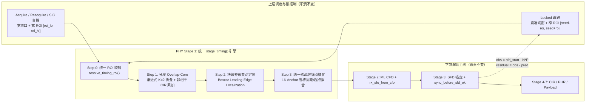

# Stage 1 Timing 统一 CIR 累加架构重构开发方案（2026-11-25）

> **工作边界与证据口径**
> - 本方案覆盖 `openuwb_phy_hrp` 的 **Stage 1 Timing（`stage_timing()`）** 及与其直接耦合的 `DemodScratch`、白盒单测与运行时调用约定，**不改动** Stage 2 ML CFO、Stage 3 SFD、CIR/Soft-Chip、PHR/Payload 解码与 `TargetLockCore` 锁状态机算法。
> - 方案验收以仓库 `testdata/` 下实采 SC16 离线回放（`openuwb_rx --replay`）、合成单元/重型 QA 及跨预设构建为准，**不作为上板实测或 MATLAB 逐样点验收证据**；未完成的 MATLAB 交叉验证与上板验证须在验收报告中显式列出。
> - 完整帧成功率仅统计 `PACKET status=OK && fcs=1 && crc=1`，不把 SFD-only、前端种子数或 Timing 命中率折算为 FCS 成功率。

---

## 1. 背景、问题诊断与核心设计哲学

### 1.1 前置基础（2026-11-25 全场景回归结论）

在 [解调主线全场景回归测试报告（2026-11-25）](performance/解调主线全场景回归测试报告_2026-11-25.md) 中，三项根治修改（SFD `sync_before_sfd_ok()` 物理一致性门控、`TargetLockCore::Verify` 连续残差异常自动脱困、CFO Stage-2 主线统一并退役影子稠密网格）已通过 184 轮串行 ABBA 离线回归与全套跨预设门禁：
- 全场景 **`CFO_FAILED = 0`、`PHR_FAILED = 0`、`FCS_FAILED / CRC_CHECK_FAILED = 0`**；
- `try2_loose` 6/6 轮自愈并稳定 `locked`（锁后 FCS **367/376 = 97.6%**）；
- OK 路径 `demod_us` 普遍下降 **0.89%–7.38%**。

回归报告 §6.2 与 [开发状态](../开发状态.md) 同时锁定了当前主线的核心短板已全部收敛至 **Stage 1 Timing**：
1. **强干扰下的前导捕获失败**：`jam688` 中 **87.9%**（5208/5927）、`jam884` 中 **50.4%**（2117/4198）窗口死于 `TIMING_FAILED`，导致锁定长期停留在 `holdover`；`near200`（440）、`clean_310cm_1125`（548）、`clean_try2`（180）亦存在可观的捕获失败。
2. **大 CFO（`±100 kHz`）入口瓶颈**：`try2` 离线 `+100 kHz` CFO 注入下，前端 `xcorr` 已能产生 97 个有效种子，但 Stage 1 的单符号/大 `K` 相干折叠（`K=64` 在 `>7.7 kHz` 即相消归零）无法稳定接住种子，导致最终完整帧仅 0–1 帧。
3. **代码与语义严重割裂**：`lib/phy/hrp/uwb_demod_timing.cc`（1540 行）+ `uwb_demod_timing_fold.cc`（510 行）共 **2050 行**，将上层调度模式耦合进 PHY 内部，演化出两套完全不同的检测/跟踪世界与 10+ 级回退补丁。

### 1.2 现状结构性缺陷

| 维度 | 现状（割裂架构） | 根因与危害 |
|---|---|---|
| **模式耦合** | `AcquireLegacy` 与 `LockedBounded` 在 `stage_timing()` 内分叉为 `acquire_unbounded_seed()` 与 `acquire_locked_bounded()` 两套独立状态机 | 相同物理信号因上层是否锁周期走完全不同的检波/门限/回退逻辑，维护成本高且 bug 难以跨模式收敛 |
| **强依赖 `seed_start`** | `inner_probe` / `tail_sweep` 假设 `seed_start` 精确落在 SYNC #0；`fold_acquire()` 强行裁到 `centre ± P/2`；`disambiguate_fold_leading_edge()` 依赖单符号 `0.003f` 阈值消整周期模糊 | 弱前导噪声毛刺会触发提前 20–30 符号误锁（如 `try2_loose` `id=11`）；头部突发干扰迫使单独维护 `tail_sweep` |
| **抗突发干扰与大 CFO 失衡** | 宽/低 SNR 兜底采用 `K=64` 原始波形直接相干叠加 | ① 单段强干扰会把整个 `fold_buf` 能量分母拉高 20 dB，淹没其余干净 SYNC；② `K=64` 仅容忍 `<7.7 kHz` CFO，超出即相消失效，被迫依赖低 SNR 下不可靠的 `probe_fold_phase()` |
| **冗余 256 符号逐峰追踪** | `track_locked_grid`（16 锚点 + 256×8 lag）与 `track_sync_train`（256×17 lag）在 Stage 1 重复扫满整条前导 | 下游已全面切换为 **Stage 2 ML CFO（零解缠周期图）+ Stage 3 SFD 锚定重建 + `rx_sfo_from_cfo`**，256 峰逐点跟踪已高度冗余 |
| **SIC 独立外挂路径** | `rx_wide_interval_probe` 在 `acquire_unbounded_seed()` 中以 `if` 补丁形式存在 | 盲捕窗口与正常捕获无法共享同一套分段检测器与早退统计门限 |

### 1.3 核心设计哲学：职责彻底解耦

> **上层（Runtime / `TargetLockCore` / `openuwb_rx` / `SIC`）只负责时间窗切分、搜索区间 `[roi_lo, roi_hi]` 约束与周期锁状态机；下层 PHY `stage_timing()` 无论是否拥有精确时间基准，始终执行同一套基于 CIR 能量累加的物理检测与块级起点定位引擎。**

这一划分带来四个直接收益：
1. **Acquire 与 Locked 物理完全一致**：唯一的区别只是合法起点搜索范围 `[roi_lo, roi_hi]` 的宽度以及 Locked 模式对越界结果的严格 fail-closed 合同；
2. **自然覆盖全场景**：高 SNR 快路径、`-14 dB` 极低 SNR、突发强干扰（头部/中部/尾部覆盖）、`±100 kHz` 大 CFO、`±50 ppm` 大 SFO、SIC 整窗快失（`L0_Bypass`）全部由同一套数学引擎无缝覆盖；
3. **代码体量收敛 60%+**：预计将 `uwb_demod_timing.cc` + `uwb_demod_timing_fold.cc` 从 ~2050 行收敛至 ~700–900 行内聚清晰模块；
4. **性能持平或更快**：高 SNR 通过渐进早退 + 取消 256 符号逐峰追踪降低 `st_timing`；低 SNR / 噪声失败窗通过统一 `K=2` 渐进拒判显著降低最坏耗时。

---

## 2. 统一 Timing 引擎详细设计（4 阶段流水线）

记单个 SYNC 符号长度 $P = \text{kQm35SamplesPerSymbol} = 1016$ 样点（$T_{\text{sym}} = 1016 / 998.4\text{ MHz} \approx 1.0176\,\mu\text{s}$），模板长度 $L = \text{template\_wf.size()}$（通常 $L = P = 1016$），前导重复数 $N_{\text{rep}} = \text{profile.preamble\_repetitions}$（64 或 256）。匹配滤波器沿用现有 `PreparedTimingFilter`（`SyncMatchedFilter` 支持 dense / sparse / shaped-sparse，复用 AVX2/AVX-512 16/32-lag 批量内核）。

### 2.1 Step 0：统一合法起点区间映射 `resolve_timing_roi()`

将上层传入的 `seed_start` 与 `profile` 映射为统一的合法起点闭区间 $[\text{roi\_lo},\, \text{roi\_hi}] \subseteq [0,\, n - L]$：

| 调用模式 | 判定条件 | $[\text{roi\_lo},\, \text{roi\_hi}]$ 计算规则 | 越界策略 |
|---|---|---|---|
| **Locked 有界模式** | `sync_strategy == SyncStrategy::LockedBounded` | `seed_start < 0` 直接 fail-closed；否则 `roi = max(1, locked_roi_samples)`，`[clamp(seed - roi), clamp(seed + roi)]` | **严格 fail-closed**：Step 1/2/3 搜索与最终输出 `preamble_start_sample` 严禁越出 `[roi_lo, roi_hi]`（允许 Step 3 回归亚样点/微调容差 `±16` 样点且仍受 `[seed - roi - 16, seed + roi + 16]` 硬钳位），`bounded_legacy_scans` 恒为 0 |
| **Acquire 有种子模式** | `sync_strategy == SyncStrategy::AcquireLegacy && seed_start >= 0` | `margin = max(256, timing_search_margin)`（保持 `margin == 0` 时兼容 `±256` 局部搜索的既有语义），`[clamp(seed - margin), clamp(seed + margin)]` | 按距离 `seed_start` 由近及远扫描子区 |
| **完全盲捕 / SIC 整窗** | `sync_strategy == SyncStrategy::AcquireLegacy && seed_start < 0` | `[0, n - L]` | 全窗分段扫描，结合快失门限支持 SIC `L0_Bypass` |

### 2.2 Step 1：分段 Overlap-Core + 渐进式 CIR 能量累加

#### 2.2.1 公共核心区定理（Overlap-Core Partitioning）

如何在**同一套循环**里同时支持窄 ROI（513 lags）、中 ROI（`±8192`）、宽 ROI（`±131072`）与整窗盲捕（400k 样点）？

- 设单段最大跨度 $W_{\text{seg}} = \max\!\left(P,\; \lfloor N_{\text{rep}} / 2 \rfloor \cdot P\right)$（256-SYNC 时 $128 P \approx 130\text{k}$ 样点；64-SYNC 时 $32 P \approx 32.5\text{k}$ 样点）。
- **情形 A（窄 ROI：`roi_hi - roi_lo < P`，典型 Locked `±256`）**：
  - 仅 1 个子区 `seg = [roi_lo, roi_hi]`；
  - 扫描长度 `scan_len = roi_hi - roi_lo + 1`（例如 `513` lags，而非全周期 `1016`）；
  - 核心区基址 `core_base = roi_lo`，可用前导符号数覆盖整个 `[0, N_rep)`（按 `n` 裁剪）。
- **情形 B（宽 ROI：`roi_hi - roi_lo >= P`，典型 Acquire / 盲捕 / SIC / 宽 Locked）**：
  - 将 `[roi_lo, roi_hi]` 划分为 $N_{\text{seg}} = \lceil (\text{roi\_hi} - \text{roi\_lo}) / W_{\text{seg}} \rceil$ 个子区 `[seg_lo, seg_hi]`（每段宽度 $\le W_{\text{seg}}$）：
    - `±8192`（256-SYNC）：**1 段**；
    - `±131072`（256-SYNC）：**2–3 段**（以 `seed_start` 为中心优先排列，命中中心段即早退，不扫远端）；
    - SIC 400k 整窗（256-SYNC）：**3 段**；
    - `±40960`（64-SYNC）：**3 段**。
  - **Overlap-Core 性质**：只要真实前导起点 $s \in [\text{seg\_lo},\, \text{seg\_hi}]$，则区间
    $$[\text{core\_base},\, \text{core\_end}) = \big[\text{seg\_hi},\; \min(n,\, \text{seg\_lo} + N_{\text{rep}} P)\big)$$
    **100% 完全落在真实前导内部**，且长度至少 $\lceil N_{\text{rep}} / 2 \rceil P$（256-SYNC $\ge 128$ 符号，64-SYNC $\ge 32$ 符号）。
  - 边界截断保护：若尾部最后一个子区因贴近缓冲末梢导致 `core_end - core_base < min_core_syms * P`（`min_core_syms = min(8, N_rep/4)`），将其起点回缩或并入前段；对于部分截断窗（如 SIC `clipped_sfd_l1_ok`），只要剩余可用符号数 $\ge 4$ 仍允许检测。
  - 在每个子区，只需对 `core_base` 之后的周期网格执行长度为 `scan_len = P`（1016 lags）的 CIR 累加，即可精确锁定前导的**周期内相位** $\tau^* \in [0, P)$。

#### 2.2.2 组相干折叠（$K_g = 2$）+ 逐组归一化非相干 CIR 累加

在单个子区内，以 $K_g = 2$ 个相邻 SYNC 符号为一组（当核心区可用符号数 $< 4$ 时自动退化为 $K_g = 1$）：
1. **组内相干折叠**：对第 $g$ 组（起始偏移 $b_g = \text{core\_base} + m_g \cdot P$）：
   $$y_g[\tau] = x[b_g + \tau] + x[b_g + P + \tau], \quad \tau \in [0,\, \text{scan\_len} + L - 1)$$
   （零旋转，直接复用 `rxopt::vector_accumulate_complex` SIMD 加法）。
2. **组级复数 CIR 与归一化功率谱**：调用现有批量 SIMD `rxopt::scan_normalized_sync(filter, y_g, scan_len, pw0, Et, group_rho)`，一次扫描输出全滞后归一化功率谱：
   $$\rho_g[\tau] = \frac{\left|\langle y_g[\tau \dots \tau+L-1],\, h \rangle\right|^2}{E_g[\tau] \cdot E_t + \epsilon} \in [0, 1]$$
3. **非相干 CIR 能量累加（平均 PDP）**：
   $$S_G[\tau] = \frac{1}{G} \sum_{g=0}^{G-1} \rho_g[\tau]$$

#### 2.2.3 数学性能验证（为何 $K_g = 2$ + 逐组归一化非相干累加是最优解）

| 极端场景 | 旧架构（单符号 + `K=64` 折叠） | 统一引擎（$K_g = 2$ + 逐组归一化非相干累加） |
|---|---|---|
| **大 CFO `±100 kHz`**（$\Delta\theta = 36.6^\circ/\text{sym}$） | `K=64` 在 `>7.7 kHz` 直接相消归零；`K=4` 损耗 `-2.34 dB`；依赖脆弱 `probe_fold_phase` | $\cos^2(\Delta\theta/2) = \cos^2(18.3^\circ) = 0.901$，仅损耗 **`-0.45 dB`**！即使 `±200 kHz` 也仅损耗 `-1.9 dB`，**完全无零点、无需任何相位估计前置** |
| **极低 SNR `-14 dB` 带内** | 单符号失败后触发 `K=64` 折叠（~1 ms） | 单组 $\rho_2 \approx 0.039$（sparse）/ `0.072`（shaped），纯噪声期望 $\mu_0 \approx 1/1016 \approx 0.001$；累加 $G=32$ 组（64 符号）后，背景标准差压至 $\mu_0/\sqrt{32} \approx 0.00018$，纯噪声 1016-lag 最大值 $\approx 0.0018$（$\text{PAR} \approx 1.8\text{–}2.3$），真实信号 **$\text{PAR} \approx 39\text{–}72$（$>13\text{ dB}$ 检测裕量）** |
| **强突发干扰**（如前 20–150 符号被高 +20 dB 干扰覆盖） | `K=64` 原始波形直接相加，1 个被干扰符号即可把分母 $E_{\text{fold}}$ 抬高 20 dB 导致全盘崩溃；需特判 `tail_sweep` | **逐组归一化自带逐组 AGC**：被干扰组 $E_g$ 大 $\implies \rho_g \approx 0$，**绝不污染其他干净组的分母**；干净组 $\rho_g \in [0.1, 0.8]$ 稳定拉出尖峰，天然免疫头部/中部/尾部任意突发干扰 |
| **大 SFO `±50 ppm`**（256 符号累计漂移 13 样点） | 长窗整周期折叠在 256 符号上严重展宽 | 核心区按 **64-symbol SFO-safe 子块**（每块 32 组）组织：块内 50 ppm 漂移 $\le \pm 1.6$ 样点（27 ppm $\le \pm 0.88$ 样点），零展宽；极低 SNR 需跨块合并时做 `±8` 样点循环偏移对齐后再叠加至 64 组（128 符号） |
| **高 SNR 延迟** | 单符号快，但需跑 256 符号逐峰追踪 | 块内位反转渐进抽样：第一批 **4 组（8 符号）**即达超高置信度早退，Locked 窄窗仅 `4 × 513 lags ≈ 35–45 µs`，配合 16 锚点精化（~15–20 µs），总耗时与现状持平甚至更快 |

#### 2.2.4 渐进早退与循环背景 PAR 双门控

1. **SFO-safe 块内位反转（Bit-Reversed）抽样顺序**：
   - 将核心区划分为至多 3 个 64-symbol（32 组）子块（256-SYNC 选核心区的前/中/后块，优先中块；64-SYNC 仅 1 块）。
   - 块内组索引按位反转序列排列（如 32 组的前 4 组均匀落在 `0, 16, 8, 24` 即 0%/25%/50%/75% 处），确保即使局部存在连续突发干扰，第一批 4 组也能立即抽中干净段。
2. **渐进阶段与门限表**（自由度 $2G$ 的 $\chi^2$ 极值分布标定，确保纯噪声 0 虚警）：

| 阶段 | 累计组数 $G$（等效符号数） | 纯噪声 1016-lag 最大 PAR（99.99% 分位） | 接受门限：`PAR >= T_par` **且** `S_peak >= T_abs` | 说明 |
|---|---:|---:|---|---|
| **Batch 1（快检早退）** | 4（8 符号） | ~6.5 | `PAR >= 14.0` 且 `S_peak >= 0.040` | 高/中 SNR 与轻微干扰包直接早退（~35–60 µs） |
| **Batch 2（中低 SNR）** | 8（16 符号） | ~4.2 | `PAR >= 9.5` 且 `S_peak >= 0.025` | 覆盖中重度突发干扰与 `-8 dB` |
| **Batch 3（低 SNR）** | 16（32 符号） | ~3.0 | `PAR >= 7.0` 且 `S_peak >= 0.015` | 覆盖 `-12 dB` 及重度干扰 |
| **Batch 4（深累块满）** | 32（64 符号） | ~2.3 | `PAR >= 5.5` 且 `S_peak >= 0.010` | 覆盖 `-14 dB`、64-SYNC 全前导、大 CFO |
| **Batch 5（跨块对齐深累）** | 64（128 符号，仅 `N_rep >= 128`） | ~1.85 | `PAR >= 4.5` 且 `S_peak >= 0.008` | 相邻 64-symbol 块做 `±8` 样点互相关对齐后合并，应对 `-14/-16 dB + 50 ppm SFO + 100 kHz CFO` |

> **关键边界保护**：
> - **循环背景均值计算**：在 $S_G[0 \dots \text{scan\_len}-1]$ 上排除峰值 $\tau^*$ 周围保护带 $\pm G_{\text{guard}}$（默认 `40` 样点，覆盖 UWB 多径扩展，防止多径后径拉高底噪；全周期 `scan_len == P` 时使用循环距离 `min(|i - tau*|, P - |i - tau*|)`）。
> - **极窄 ROI 背景样本不足保护**：若调用方设置极窄 ROI（例如 `--locked-roi 32`，`scan_len = 65`），导致排除保护带后背景点数 $< 64$，则在 Step 1 累加时将**物理扫描跨度对称扩宽到 `bg_scan_len = max(scan_len, 192)`** 仅用于测量真实背景底噪 $S_{\text{bg}}$，而**峰值 `argmax` 仍严格限制在原始合法区间 `[roi_lo, roi_hi]` 内部**！既不违反 Locked 有界合同，又保证窄 ROI 下 PAR 统计不退化。
> - **长突发干扰跨块探测**：对于 `N_rep >= 128`（如 256-SYNC），若当前 64-symbol 块在 Batch 1（4 组）峰值很弱（例如整段前 64 符号都被突发干扰压死），在进入 Batch 2 深累之前，先用 4 组快探下一个 64-symbol 块（最多 3 块 $\times$ 4 组），优先把深累算力投向最干净的 64-symbol 块！
> - **SIC 无目标窗快失（`L0_Bypass` 延迟控制）**：对于 SIC 整窗盲搜（当 `cfg.rx_wide_probe_fallback == false` 或快失开关开启时），若全部 3 个子区在 Batch 1（或 Batch 2）均远低于极低 SNR 底线（如 `PAR < 4.0` 且 `S_peak < 0.008`），直接早退返 `false`，将空白窗开销控制在 ~100–180 µs 级别。

---

### 2.3 Step 2：块级定长矩形变点定位（Boxcar Leading-Edge Localization）

当 Step 1 命中子区并输出参考锚点 `anchor_pos = core_base + tau*` 与实测背景底噪 $S_{\text{bg}}$ 后：

1. **窄 ROI 直通（`seg_hi - seg_lo < P`，典型 Locked `±256`）**：
   - 合法起点区间内仅包含 1 个模 $P$ 候选：`start_cand = seg_lo + tau*`。
   - **直接跳过整周期消歧进入 Step 3**（0 额外开销，且从数学上保证头部 20 符号全被噪声淹没的 Locked 包绝对不会向后漂移！）。

2. **宽 ROI 块级变点定位（`seg_hi - seg_lo >= P`，典型 Acquire / 盲捕 / SIC）**：
   - 沿一维周期网格 $p_m = \text{anchor\_pos} + m \cdot P$ 覆盖区间 `[seg_lo - 8*P,\, min(n - L, seg_hi + (N_rep + 12) * P)]`（含前护区、完整前导及 SFD/Payload 后缀，总点数 $M \le 400$）。
   - **SFO 自适应网格追踪**：以 `anchor_pos` 为中心分别向左、向右推进，每 32 个符号对局部 1 个符号做 `±2` 样点（5 lags）微调并微调格点偏移，避免 `±50 ppm` SFO 在 256 符号两端偏离脉冲主峰。
   - 对每个网格点 $m$ 计算单符号归一化相关能量 $\rho[m] = \frac{|\text{filter.dot}(rx + p_m)|^2}{\text{window\_power}(rx + p_m, L) \cdot E_t + \epsilon}$（单点计算，全网格耗时仅 **~5–15 µs**）。
   - **无魔数自适应截断得分**：
     - 取核心区内部（已知属于前导）的 $\rho[m]$ 的 **75% 分位数**作为有效信号水平 $\hat{\mu}_{\text{sig}}$（抗头部/局部突发干扰）；
     - 结合 Step 1 实测背景底噪 $S_{\text{bg}}$ 定义自适应中点门限：
       $$\theta = \max\!\left(3.5\, S_{\text{bg}},\; 0.25\, \hat{\mu}_{\text{sig}}\right)$$
     - 每个符号映射为有界得分 $s[k] \in [-1, +1]$（防止单个强峰或干扰尖峰主导）：
       $$s[k] = \text{clamp}\!\left(\frac{\rho[k] - \theta}{\max(\hat{\mu}_{\text{sig}} - \theta,\, 10^{-6})},\; -1.0,\; +1.0\right)$$
   - **定长前导矩形匹配积分（O(M) 前缀和实现）**：
     - 对所有落在合法搜索区间 `p_m ∈ [seg_lo, seg_hi]` 的候选起点 $m$，计算长度为 $N_{\text{rep}}$ 的截断矩形得分：
       $$J(m) = \sum_{k = m}^{\min(m + N_{\text{rep}},\, M) - 1} s[k]$$
     - **SFD 非零符号与左边界精确性证明**：
       - 前导 SYNC 占 $[m_{\text{true}},\, m_{\text{true}} + N_{\text{rep}})$，后续 `4z2` SFD（8 个 $\pm 1 \times \text{SYNC}$ 符号）单符号模平方 $\rho[k]$ 同样较高，因此 $J(m)$ 在 $[m_{\text{true}},\, m_{\text{true}} + 8]$ 上形成平顶最大值，而在 $m_{\text{true}} - 1$ 处因吃进前缀噪声骤降 $-2$。
       - 因此取最大平台 $\{m \mid J(m) \ge J_{\max} - 1.0\}$ 的**最左端点 $m_{\text{left}}$**，在无头部完全淹没时**精确命中 $m_{\text{true}}$（误差 0 符号）**！
       - 当噪声区出现 1 个随机毛刺（如 `try2_loose` `id=11`）时，毛刺后的几十个噪声符号全部贡献 $-1$，**绝对不会**引发提前误锁！
       - 当头部 $d$ 个符号被突发干扰完全淹没时，若平台宽度 $> L_{\text{sfd\_nz}} + 2$ 且平台右端紧邻下降沿（尾部边缘清晰），最左端仍能自动向真起点回拉，剩余极小偏移（$\le L_{\text{sfd\_nz}}$）由 Stage 3 SFD（支持 $\pm 4$ 窄窗 + $\pm 36$ 离散网格）100% 精确锚定。
   - **扫描边界防截断守卫**：若选出的 $m_{\text{left}}$ 紧贴子区左边界 `seg_lo` 且其左侧 4 个前护符号均满足 $s[k] > 0$（说明真正的前沿还在当前子区左侧，且仍在全局 `[roi_lo, roi_hi]` 内），则自动向左扩展网格追踪到真正噪声前沿（不超过 `roi_lo`）。

---

### 2.4 Step 3：统一稀疏超锚点精化与鲁棒周期拟合

拿到 Step 2 的粗起点 `start_cand`（精度已达 $\pm 1\text{–}2$ 样点、$\pm 0\text{–}1$ 符号）后，执行统一精化：

1. **均匀锚点布局**：在 `[0, N_rep - K_a]` 内均匀选取至多 **$N_a = 16$** 个锚点索引 $k_0 < k_1 < \dots < k_{N_a - 1}$（强制包含靠近首尾的端点，确保最大时间基线）。
2. **锚点组长选择**：
   - 使用 **$K_a = 2$** 符号相干折叠（若某锚点靠近缓冲末尾不足 2 符号则退化为 $K_a = 1$）；
   - 在 $\pm 100\text{ kHz}$ 大 CFO 下，$K_a = 2$ 相干损耗仅 `-0.45 dB`，同时比单符号多 `+3 dB` 信噪比，兼顾低 SNR 与大 CFO！
   - 对每个锚点，在预测位置 $p_{\text{pred}}(k_i) = s_{\text{hint}} + \text{llround}(k_i \cdot p_{\text{hint}})$ 周围执行 **$\pm 8$ 样点（17 lags）** `scan_normalized_sync`（单次 AVX2 16-lag + 1 scalar，16 个锚点全程仅 **~15–20 µs**）。
3. **两步鲁棒线性拟合（2-Pass Robust LinearFit）**：
   - **Pass 1**：筛选有效锚点（要求锚点归一化指标 $m_i \ge \max(3.5\, S_{\text{bg}},\, 0.04)$ 且 $\ge 0.15\, m_{\max}$），记录 `(x = k_i, y = pos_i + L - 1)`（沿用既有 symbol-END 约定）。
   - **抗干扰离群点剔除**：若有效锚点数 $\ge 5$，初拟 `(p0, s0)` 后计算残差 $r_i = |y_i - (s_0 + p_0 k_i)|$，剔除 $|r_i| > 3.5$ 样点的离群锚点（防止个别锚点恰好撞上强突发干扰或假峰拉偏周期），用内点重拟 `(p1, s1)`。
   - **Pass 2（大 SFO 自动精化）**：若 Pass 1 有效且 $|p_1 - P| \cdot N_{\text{rep}} > 4.0$（对应 $>15\text{ ppm}$ 未校准晶振，如 `50 ppm` QA 夹具），以 `(p1, s1)` 重新预测锚点中心并做第二轮 `±8` 精搜与拟合，确保 50–100 ppm 大 SFO 下全前导每个锚点都不偏离搜索窗。
   - **合理性门控**：拟合周期必须落在标称 $P = 1016$ 的 `±0.5%` 内（否则退化为标称 `1016.0` + `start_cand`）；若总有效锚点数 $< \min(4,\, \text{min\_valid\_peaks})$，在极低 SNR 确认场景下回退采用 Step 1 峰值锚点（若连 Step 1 置信度也不足则判失败）。
4. **Locked 边界终检（fail-closed）**：
   - 若 `sync_strategy == SyncStrategy::LockedBounded`，检查最终 `preamble_start_sample` 必须满足 `|preamble_start_sample - seed_start| <= locked_roi_samples + 16`；若因异常拟合外推越界，按失败返回（`bounded_failures = 1`）。
5. **物理归一化 `out.metric` 与结果填充**：
   - `out.preamble_start_sample`：拟合原点（symbol-START）；
   - `out.measured_period`：拟合周期（实测值，用于 `integer_chip_grid()` 与无 `rx_sfo_from_cfo` 场景）；
   - `out.metric`：取有效锚点归一化相关功率的中位数（注意：**能量归一化尺度** `|corr|^2 / (E * Et)`，与原 `local_best` / golden 契约完全同量纲——无噪 golden 上 $\approx 1.0 \ge 0.95$！）；
   - `out.peak_samples / peak_metrics / peak_corr`：填入所有通过门限的实测锚点（symbol-END 坐标与对应复数相关值，保证 `stage_sfd` 非空守卫与 `fit_cfo()` 兜底完全可用）；
   - `out.detected_peaks`：见 §3.3 兼容契约设计；
   - `out.cir_grid_repetitions = profile.preamble_repetitions`、`out.expected_peaks = profile.preamble_repetitions`、`out.sync_peaks_folded = (K_a > 1)`；
   - `out.ok = true`。

---

## 3. 代码架构、内存零分配与对外契约兼容

### 3.1 目标文件组织与废弃路径清单

| 文件 | 重构动作 | 说明 |
|---|---|---|
| `include/openuwb/phy/hrp/rx/demod_timing.h` | **签名不变** | 保持 `stage_timing(rx, n, profile, template_wf, seed_start, out, scratch)` 零破坏 |
| `include/openuwb/phy/hrp/rx/demod_sync.h` | **精简内部声明** | 移除不再使用的旧 fold 内部函数声明（`probe_fold_phase`、`fold_acquire`、`fold_probe_acquire`、`disambiguate_fold_leading_edge`、`fold_anchor_fit`）；保留公用原语 `window_power_8acc`、`prepare_sparse_sync_template`、`ensure_shaped_sparse_template_cached`、`normalized_mf`、`fold_accumulate`（SIMD） |
| `include/openuwb/phy/hrp/rx/demod_scratch.h` | **增补预分配缓冲** | 为统一 Timing 引擎增加预分配成员并在 `reserve()` 中一次性预分配（见 §3.2），删除废弃的旧 fold 临时缓冲或复用其内存 |
| `lib/phy/hrp/uwb_demod_timing.cc` | **重写为统一引擎** | 由 1540 行精简收敛至 ~650–800 行，结构为 5 个清晰内聚单元：`prepare_timing_filter`、`resolve_timing_roi`、`accumulate_cir_segment`、`localize_leading_edge_boxcar`、`refine_anchors_robust` + `stage_timing` 总编排 |
| `lib/phy/hrp/uwb_demod_timing_fold.cc` | **退役/合并或缩减** | 若保留编译单元仅托管 SIMD 组折叠与跨块对齐内核，或直接从 `CMakeLists.txt` 移除并并入 `uwb_demod_timing.cc`（需核对 `lib/phy/hrp/CMakeLists.txt`） |
| `lib/phy/hrp/uwb_demod_pipeline.cc` | **零改动** | 继续复用 `stage_timing()` -> ML CFO -> SFD 锚定链路 |
| `lib/runtime/*` & `apps/*` | **零逻辑改动** | 保持 `--sic off` stdout 协议字段集合（30/96/49/15）逐项不变；旧 CLI 选项（如 `--locked-timing`、`--locked-roi`）继续合法解析 |

**彻底退役的旧分支列表（全部从主线移除）**：
1. `acquire_locked_bounded()` 内的 `local_best(±32 -> ±roi)`、`inner_probe (m=0..4)`、`tail_sweep(±32)` + 邻居确认门控；
2. `acquire_unbounded_seed()` 内的 `timing_seed_refine_radius` 两段窄搜、`K=4 fast_only` 特判、`rx_wide_interval_probe` 外挂分支、stride-14/stride-2 粗扫循环；
3. `try_fold_acquire()`、`probe_fold_phase()`、`fold_acquire(K=64)`、`disambiguate_fold_leading_edge()`（脆弱 `0.003f` 阈值）；
4. 逐符号回溯循环（`for (back = 0; back < backtrack_limit; ++back)`）；
5. `track_locked_grid()`（16 锚点 + 256×8 lag 跟踪）与 `track_sync_train()`（256×17 lag 跟踪）及 post-train fold retry。

### 3.2 热路径零堆分配（`DemodScratch` 预分配清单）

所有热路径缓冲全部纳入 `DemodScratch` 并在 `reserve()` 一次性预留（warm call 满足 `capacity` 零增长）：

| 缓冲名 | 预留容量 | 字节数 | 用途 |
|---|---:|---:|---|
| `fold_buf`（复用） | `4096` complex | 32 KB | Step 1 组折叠缓冲（最大 `scan_len + L = 1016 + 1016 = 2032`） |
| `fold_sup_buf`（复用） | `2048` complex | 16 KB | Step 3 锚点 `K_a=2` 局部折叠缓冲（`L + 16 = 1032`） |
| `timing_cir_acc`（新增） | `1024` float | 4 KB | Step 1 当前 64-symbol 块非相干 CIR 累加谱 $S[\tau]$（常驻 L1 cache） |
| `timing_cir_acc_alt`（新增） | `1024` float | 4 KB | Step 1 跨块 `±8` 对齐合并时的副块累加谱 |
| `timing_fold_lag_metrics`（复用） | `2048` float | 8 KB | Step 1 单组 `scan_normalized_sync` 临时输出 $\rho_g[\tau]$ |
| `timing_fold_cand_metrics`（复用） | `512` float | 2 KB | Step 2 变点网格单符号 $\rho[m]$ 与得分 $s[m]$ |

### 3.3 对外接口、诊断字段与 `detected_peaks` 兼容约定

1. **stdout 协议（`--sic off`）100% 兼容**：
   - `TimingResult` 中所有被 `apps/console_reporter.h` 引用的结构体字段（`bounded_*`、`grid_*`、`tail_probe_*`、`backtrack_symbols`、`seed_refine_*` 等）**全部保留定义**，不删字段、不改名。
   - 跨层契约字段继续真实填充：
     - `bounded_attempts` / `bounded_success` / `bounded_failures` / `bounded_roi_samples` / `bounded_legacy_scans (= 0)`（`LockedBounded` 模式下与既有语义完全一致）；
     - `coarse_search_us`（记录 Step 1 CIR 累加耗时）与 `fine_track_us`（记录 Step 2 + Step 3 耗时）；
     - 已退役旧策略字段（`tail_probe_*`、`grid_fallbacks`、`backtrack_symbols`、`seed_refine_*`）自然保持 `0` / `-1` 初始值。
2. **`detected_peaks` 与 `peak_samples` 的语义约定（需明确）**：
   - Step 3 实测至多 16 个稀疏超锚点，`peak_samples` / `peak_metrics` / `peak_corr` 严格存放真实测量值（保证 `fit_cfo()` 兜底不会读到伪造的 0 相位）。
   - 对于 `detected_peaks` 字段，有两个可选方案：
     - **方案 A（推荐，真实反映实测锚点数）**：`out.detected_peaks = out.peak_samples.size()`（至多 16），`out.cir_grid_repetitions = profile.preamble_repetitions`（64 或 256）。这与当前 `fold_anchor_fit` 路径完全一致（`qa_uwb_timing_refactor.cc` 早已验证 `detected_peaks == peak_samples.size() <= 16`、`cir_grid_repetitions == kReps`，且 `estimate_cir()` 和 `uwb_sic_unified.cc` 均已优先读取 `cir_grid_repetitions`）。
     - **代价核对**：全仓库仅 3 处既有单测在无 `fold` 路径上硬断言 `detected_peaks == 64` 或 `40`（见 §3.4 迁移表），均属旧 256/64 逐峰跟踪时代的白盒契约，随重构更新为断言 `cir_grid_repetitions == 64` + `detected_peaks >= 4` 即可。
     - **方案 B（仅在极度保守时需要）**：`detected_peaks` 报告 `boxcar` 有效前导符号计数，但会导致 `detected_peaks != peak_samples.size()`，破坏下游不变量，**不推荐**。
   - 特别检查 `lib/phy/hrp/uwb_demod_pipeline.cc:396`：`build_sfd_anchored_timing()` 中 `cfo_timing.detected_peaks = initial_timing.detected_peaks; cfo_timing.peak_samples.resize(cfg.full_repetitions);` —— 采用方案 A 时，`qa_uwb_demod_core_fec_joint_ml.cc:739`（断言 `res_fb.timing.detected_peaks == 64`）同步核对并更新为检查 `cir_grid_repetitions == 64` 与 `peak_samples.size() == 64`。
3. **`Qm35825Profile` 旧开关字段**：
   - `locked_tail_probe`、`locked_grid_timing`、`timing_seed_refine_radius`、`rx_wide_interval_probe`、`rx_wide_probe_fallback` 等公共配置字段保留 ABI 兼容并标注注释说明：
     - 其中 **`rx_wide_probe_fallback == false`（SIC 空白窗快失语义）** 可继续作为统一引擎的“快失模式”提示（当为 `false` 且处于整窗盲搜时，Batch 1/2 无显著峰则跳过深累直接早退，确保 SIC `L0_Bypass` 延迟不回退）；
     - 其余旧策略开关不再分叉独立代码路径（`locked_tail_probe == false` 等历史白盒测试按 §3.4 迁移）。

### 3.4 既有 QA 审计与分类迁移清单

> **铁律**：物理精度与防虚警不变量（起点误差、周期测量精度、低 SNR 检出、大 CFO/SFO、0 虚警、零堆分配、Locked 越界拒判、完整帧 FCS）**绝不放宽**；仅迁移绑定已退役内部实现细节的白盒计数器断言。

| 测试文件 | 测试用例 | 分类 | 处理方式 |
|---|---|---|---|
| `tests/unit/runtime/qa_uwb_target_lock_core.cc` | 全部（含 LockedBounded 越界不扩扫） | **物理/架构合同** | **原样通过，零修改** |
| `tests/unit/phy/qa_uwb_demod_core_timing_cfo_sfd.cc` | `test_demod_core_r1_timing_matches_golden` | 物理合同 + 1 行白盒 | 保持 `start ≈ 9984`、`period ≈ 1016`、`metric >= 0.95`、`peak_samples.front() ≈ 10999`；`detected_peaks == 64` 改为 `cir_grid_repetitions == 64 && detected_peaks >= 8` |
| `tests/unit/phy/qa_uwb_demod_core_timing_cfo_sfd.cc` | `test_locked_grid_timing_period_is_measured_not_nominal` | **物理合同（50 ppm）** | 保留 `measured_period ≈ 1015.949` 与 `!integer_chip_grid` 全部物理断言；移除已退役的 `grid_anchor_hits / grid_fallbacks` 计数器检查 |
| `tests/unit/phy/qa_uwb_demod_core_timing_cfo_sfd.cc` | `test_locked_tail_probe_rescues_leading_interference` | **物理合同（头部 20 符号干扰）** | 保留核心物理断言（前 20 符号被噪声替换时仍精确还原 `kStart ± 4` 与 `period ≈ 1016`、`bounded_legacy_scans == 0`）；移除旧 `tail_probe_hits / grid_anchor_hits / locked_tail_probe=false` 内部白盒断言 |
| `tests/unit/phy/qa_uwb_demod_core_timing_cfo_sfd.cc` | `test_demod_core_tail_seed_refine_radius_fallback`、`test_locked_grid_timing_matches_legacy_train` | 旧内部白盒 | 替换为统一 Timing 等价性与大偏移恢复测试（验证 `tail_start` / `tail_start + 12` 均精确恢复且端到端 golden 解码逐位一致） |
| `tests/unit/phy/qa_uwb_timing_refactor.cc` | `k4_fast_path_hits_low_snr`、`warm_call_does_not_grow_scratch`、`rejects_late_seed_boundary`、`pure_noise_no_false_alarm`、`fallback_survives_cfo_and_sfo` | **核心物理合同** | 保留并**强化**全部物理断言（增补 `±100 kHz` CFO 与 `±50 ppm` SFO！）；更新 `coarse_search_us == 0`（因 Step 1 计时现在真实记录在 `coarse_search_us`）及 `DemodScratch` 快照列表 |
| `tests/unit/phy/qa_uwb_timing_refactor.cc` | `test_locked_bounded_pure_noise_does_not_wide_tail_sweep`、`test_timing_wide_interval_probe_keeps_k64_fallback` | 旧内部白盒 | 迁移为验证纯噪声 Locked 0 虚警 + 耗时/扫描有界，以及宽窗盲搜在 `-12 dB` 精确检出 |
| `tests/unit/phy/qa_uwb_demod_core_fec_joint_ml.cc` | lines 715–739 | 1 行白盒 | 若采用 §3.3 方案 A，更新 `detected_peaks == 64` 为 `cir_grid_repetitions == 64`（其余 `peak_samples.size() >= 64`、`peak_corr`、FCS 全部原样保留） |
| `tests/unit/runtime/qa_uwb_live_packet_processor_sic.cc` | SIC 整窗快失与检出 | **核心合同** | **原样通过**（验证 L0_Bypass 拒判与干扰检出无回归） |
| `tests/unit/phy/qa_uwb_demod_core_heavy_grid.cc` | `-L heavy` 6 项低 SNR/多径网格 | **核心物理合同** | **原样通过，零修改** |

---

## 4. 分阶段实施路线（Phase 0 → Phase 4）

### Phase 0：基线固化与新增护栏单测
1. **代码基线固化**（需用户确认）：将已通过 2026-11-25 全场景回归的 11 个修改文件、[回归测试报告](performance/解调主线全场景回归测试报告_2026-11-25.md) 与 [开发状态](../开发状态.md) 提交到 `main`（或切出独立开发分支 `feature/unified-timing-cir`），作为本轮 Timing 重构的干净 A 侧基线。
2. **补齐新场景单元测试用例**（在 `tests/unit/phy/qa_uwb_timing_refactor.cc` 中新增）：
   - `test_unified_timing_survives_100khz_cfo_low_snr`：`-12 dB` / `-14 dB` + **`±100 kHz` CFO**（同时覆盖 `AcquireLegacy` 与 `LockedBounded`，要求起点误差 $\le 2$ 样点）；
   - `test_unified_timing_survives_burst_interference_acquire_and_locked`：前导头部 40 符号、中部 60 符号、尾部 40 符号分别叠加 +20 dB 高斯突发干扰，Acquire 与 Locked 模式均需检出并精确还原起点；
   - `test_unified_timing_acquire_locked_consistency`：同一信号在 `LockedBounded(±256)`、`AcquireLegacy(±8192)`、`AcquireLegacy(±131072)` 与无 seed 盲搜（`seed = -1`）四种 ROI 下输出一致的 `preamble_start_sample`（差 $\le 2$ 样点）与 `measured_period`（差 $\le 0.02$）；
   - `test_unified_timing_boxcar_rejects_preguard_noise_spike`：在前护区 `start - 29*P` 处注入 1 个单符号强毛刺（复现 `try2_loose` `id=11` 失效机理），验证 Boxcar 定位器不被毛刺诱导，仍精确锁定真实 `start`；
   - `test_unified_timing_narrow_locked_roi_32_no_false_alarm`：极窄 `--locked-roi 32` 下纯噪声 50 窗 0 虚警 + 真实信号 100% 命中。

### Phase 1：实现统一 Timing 核心引擎（Step 0–3）
1. 在 `include/openuwb/phy/hrp/rx/demod_scratch.h` 增加 `timing_cir_acc`、`timing_cir_acc_alt` 并在 `reserve()` 中预分配；
2. 在 `lib/phy/hrp/uwb_demod_timing.cc` 实现 4 个内聚模块：
   - `resolve_timing_roi()`
   - `accumulate_cir_segment()`（含 64-symbol SFO-safe 块、位反转渐进抽样、Batch 1–5 早退/跨块 `±8` 对齐、循环保护带 PAR + 窄窗背景补足、SIC 快失早退）
   - `localize_leading_edge_boxcar()`（含 32-symbol 分段 `±2` 样点 SFO 微调、75% 分位自适应门限、O(M) 矩形匹配积分、左端优先与扫描边界保护）
   - `refine_anchors_robust()`（16 锚点、`K_a = 2`、1-pass 残差离群点剔除 + 大 SFO 自动 2-pass 精化、Locked 越界终检）
3. `dev-avx2` 跑通 `-L rx_sic`（含 Phase 0 新增单测）与 `-L heavy` 6/6。

### Phase 2：退役旧分支与清理
1. 移除 `uwb_demod_timing.cc` 与 `uwb_demod_timing_fold.cc` 中的全部 10+ 割裂分支与死辅助函数，更新 `lib/phy/hrp/CMakeLists.txt` 与 `include/openuwb/phy/hrp/rx/demod_sync.h`；
2. 按 §3.4 清单迁移旧内部白盒断言；
3. 验证热路径零堆分配（warm call `DemodScratch` capacity 不增长）及 `qa_uwb_live_packet_processor_sic`、`qa_uwb_target_lock_core` 全通过。

### Phase 3：全场景离线 ABBA 回归与专项诊断
复用 2026-11-25 回归框架（严格串行、同编译器 `/usr/bin/c++`、`sudo -n nice -n -10`、ABBA 配对）：
1. **核心 11 场景 + 5 个新实采 + 4 个 `--sic full` + 3 个特性组合**（与 2026-11-25 基线 A 做直接 ABBA 对照）：
   - 重点观测 `jam688` / `jam884` 的 `TIMING_FAILED` 占比与完整帧 FCS 变化、`try2_loose` 的自愈与锁后通过率、`clean_try2` 的 `TIMING_FAILED`/`SFD_FAILED` 变化、以及 OK/失败窗 `st_timing` 与 `demod_us`；
2. **`+100 kHz` 大 CFO 离线注入专项验证**（`try2` 去除 20 ms 块单音后移频 `+100 kHz`，搭配 `--acq-mode xcorr`）：
   - 验证统一 Timing 是否打通 `+100 kHz` 入口瓶颈，统计真实完整帧 FCS（而非仅种子数）；
3. **Phase 3B（数据驱动、按需启用，不提前过度设计）**：
   - 若 Phase 3 实测中 `jam688` / `jam884` 仍存在明显由 `jammer9`（code-9）与目标 `code-10` 20/64 互相关导致的假峰（低 `tmetric`、错误 CFO），则在 Step 1 的低幅值命中分支（例如 `S_peak < 0.12`）追加轻量**异码 PAR 鉴别 / Top-2 候选峰检查**（借用与 `preamble_xcorr_acquisition.h` 一致的相对异码比原理），再做 ABBA 复验。

### Phase 4：全量跨预设门禁与验收报告
按 `AGENTS.md` 交付标准执行全量门禁并产出验收报告 `docs/performance/Stage1_Timing统一CIR累加架构重构验收报告_2026-11-25.md` 与 `开发状态.md` 更新：
- `native-avx2` 全量构建 + 全量 `ctest`
- `no-uhd` 全量构建 + 全量 `ctest`
- `scalar-debug` 全量构建 + 全量 `ctest`
- `native-avx512` 全量编译（核验 0 error / 0 新增 warning / 0 重复强符号）
- `tests/integration/install_consumer/run_native_install_consumer.sh`（临时前缀，`ALL OK`）

---

## 5. 量化验收门禁

| 验收维度 | 硬性通过标准 |
|---|---|
| **单元测试** | `dev-avx2` `-L rx_sic` 100% 通过、`-L heavy` 6/6 通过；Phase 0 新增 5 项单测（含 `-14 dB + ±100 kHz`、突发干扰、四模式 ROI 一致性、前护毛刺拒判、极窄 ROI）100% 通过 |
| **热路径零分配** | warm call `DemodScratch` 全部缓冲 `capacity()` 零增长 |
| **纯噪声防虚警** | 50 窗宽窗 + 50 窗窄窗（含 `--locked-roi 32`）纯噪声 **0/100 虚警** |
| **Locked 越界合同** | `qa_uwb_target_lock_core` 100% 通过，`bounded_legacy_scans == 0` |
| **稳态 6 场景 FCS** | `clean_ch0`、`clean_near`、`clean884`、`clean_try2`、`near70`、`near348` 中位数差均 `≥ -1` 帧 |
| **宽松锁定自愈** | `try2_loose` 6/6 轮 `final_state=locked`，锁后通过率 `≥ 95%`（力争因根治前导误锁而减少 `reacquire` 甚至接近 390/395） |
| **强干扰场景** | `near200` / `near506` / `jam688` / `jam884` 无退化，且重点评估 `jam688` / `jam884` 的 `TIMING_FAILED` 下降与 FCS 改善 |
| **大 CFO 专项** | 合成 `-14 dB / ±100 kHz` 100% 检出（误差 `≤ 2` 样点）；实采 `try2 +100 kHz` 离线注入显著突破当前 0–1 帧瓶颈 |
| **SIC & 扩展场景** | 5 个新实采 + 4 个 `--sic full` + 3 个特性组合 0 崩溃、0 `raw_drop_samples`、0 `dropped_queue`、无系统性退化 |
| **性能约束** | OK 路径 `demod_us` 不回退（相对基线 `≤ +3%` 或 `+15 µs` 以内，目标持平或更快）；SIC 空白窗 `L0_Bypass` 不出现排队丢包 |
| **协议一致性** | `openuwb_rx --sic off` stdout 字段集合（`START 30 / PACKET 96 / LOCK_STATS 49 / FINAL 15`）逐项一致 |
| **跨预设门禁** | `native-avx2` / `no-uhd` / `scalar-debug` 全量 ctest 100% 通过；`native-avx512` 0 error / 0 新增 warning；`install_consumer` `ALL OK` |

---

## 6. 主要风险与缓解措施

| 风险 | 潜在表现 | 缓解设计 |
|---|---|---|
| **高 SNR 下 4 组累加比原单符号慢** | 原 Locked 高 SNR 仅测 1 次 `±32`（65 lags），若新引擎总扫 `4 × 513 lags` 可能导致 `st_timing` 增加 20–30 µs | ① 同步省掉了 256×8 lag 的 `track_locked_grid`（原耗时 ~60–100 µs），**整体 `st_timing` 预计净下降**；② 若 Batch 1 中前 2 组（或第 1 组 `K=2`）已达极高信噪比（`S_peak >= 0.25 && PAR >= 25.0`），可提前在 2 组处早退（仅 `2 × 513 lags ≈ 18 µs`） |
| **强异码干扰（`jammer9` code-9）触发假峰** | `jammer9` 功率高出目标 20 dB，20/64 互相关在多个组同相位累加产生 `S_peak ≈ 0.05–0.09` 假峰 | 逐组归一化已阻断其污染干净段；Phase 3 实测若仍见异码假峰，立刻按 Phase 3B 启用低幅值分支异码 PAR 鉴别/次峰保留 |
| **极短/截断缓冲（`n` 刚够容纳部分前导）** | 如 SIC `clipped_sfd_l1_ok` 或截断测试缓冲，导致 Overlap-Core 可用符号数偏小 | Step 1 自动按 `n` 缩窄子区宽度或降级 `K_g = 1`；Step 2 的矩形积分 `min(m + N_rep, M)` 天然无缝退化为左阶跃变点检测 |
| **大 SFO + 64-SYNC 锚点精度不足** | `50 ppm` 夹具在仅 16 锚点拟合时精度是否稳定 `< 0.05` 样点 | `N_rep = 64` 时跨度 62 符号，16 锚点（每 4 符号一个）Pass 2 精化后单点误差 `< 0.5` 样点，OLS 斜率标准差 `< 0.005` 样点，远优于 `0.05` 样点门限 |
| **`detected_peaks` 语义变更影响下游日志脚本** | `PACKET` 行 `sync=` 字段在高 SNR 下从 `256` 变为 `16`（实测锚点数），`sync_grid=` 保持 `256` | 完整信息已由 `sync_grid` 表达（与现行低 SNR fold 路径一致）；实施前向用户确认是否接受 `sync=` 统一为锚点数 |
